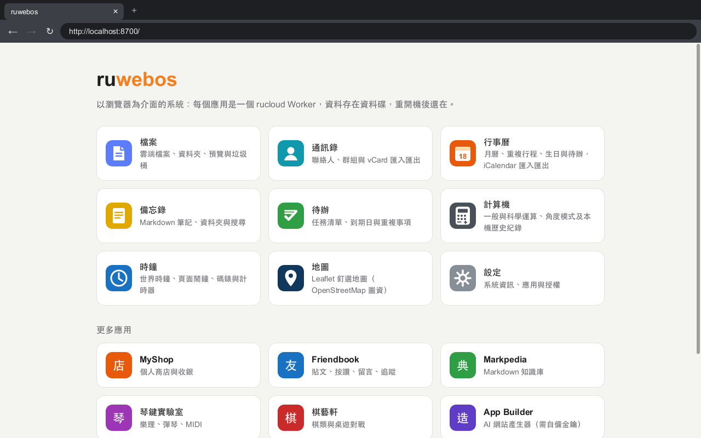

# ruwebos

以瀏覽器為介面的作業系統，支援手機與桌機。

ruwebos 把四個獨立的專案串成一個系統，使用者看到的只有瀏覽器：

| 專案 | 角色 |
|---|---|
| [ruvm](https://github.com/ccc-claude-opus/ruvm) | 虛擬機：macOS 上用 Hypervisor.framework（`-accel hvf`）、ARM Linux 上用 KVM，其他平台用直譯器 |
| Linux（Debian 13 arm64） | 核心、檔案系統、網路；使用者不直接接觸 |
| [rucloud](https://github.com/ccc-claude-opus/rucloud) | 應用伺服器：每個應用是一個 Cloudflare Workers 式的 Worker，資料放 D1 / KV / R2 / Durable Objects |
| [rubrowser](https://github.com/ccc-claude-opus/rubrowser) | 唯一的使用者介面：主畫面和應用都是網頁 |

本 repo 負責整合：系統映像的建置、一鍵啟動器、主畫面。



## 快速開始

需要：Apple Silicon 的 macOS（或 ARM Linux 加 KVM；其他平台可用較慢的直譯器）、Docker、Rust 與 [cargo-zigbuild](https://github.com/rust-cross/cargo-zigbuild)。四個 repo 放在同一層：

```bash
git clone https://github.com/ccc-claude-opus/ruvm
```

```bash
git clone https://github.com/ccc-claude-opus/rucloud
```

```bash
git clone https://github.com/ccc-claude-opus/rubrowser
```

```bash
git clone https://github.com/ccc-claude-opus/ruwebos
```

建置 ruvm（macOS 上還要簽署 Hypervisor 權限）與 rubrowser：

```bash
(cd ruvm && cargo build --release && tools/hvf-sign.sh)
```

```bash
(cd rubrowser && cargo build)
```

下載 Debian 13 的 arm64 核心，並產生 ruvm 的 initramfs（載入 virtio 與 ext4 模組、掛載系統碟）：

```bash
(cd ruvm && tools/linux/fetch-debian.sh arm64 && tools/linux/mkroot.sh arm64)
```

然後一個指令開機：

```bash
cd ruwebos && ./ruwebos
```

第一次會先建系統碟（`image/build.sh`，約半分鐘）。之後從關機到 rubrowser 顯示主畫面約 5 秒；關掉 rubrowser 或按 Ctrl-C 就正常關機。

| 指令 | 作用 |
|---|---|
| `./ruwebos` | 開機並開啟 rubrowser 到主畫面 `http://localhost:8700/` |
| `./ruwebos --headless` | 只開機，用任何瀏覽器開 `http://localhost:8700/`，Ctrl-C 關機 |
| `./ruwebos --screenshot home.png [網址]` | 開機、用 rubrowser 截圖、關機 |
| `./ruwebos --test` | 開機、跑每個應用的測試（`apps/*/test.mjs`）、關機 |
| `./ruwebos --accel tcg` | 指定加速器（預設依序 hvf → kvm → tcg） |
| `image/build.sh` | 重建系統碟 `out/system.ext4`（資料碟 `out/data.ext4` 不受影響） |

應用的網址是 `http://<名稱>.localhost:8700/`。

| 基本應用（本 repo 的 `apps/`） | |
|---|---|
| 檔案 `files` | 資料夾、上傳、預覽、垃圾桶 |
| 通訊錄 `contacts` | 群組、我的最愛、vCard 匯入匯出 |
| 行事曆 `calendar` | 月曆、重複行程、生日與待辦、iCalendar 匯入匯出 |
| 備忘錄 `notes` | Markdown、資料夾、搜尋 |
| 待辦 `todo` | 清單、期限、重複事項 |
| 計算機 `calculator` | 一般與科學運算 |
| 時鐘 `clock` | 世界時鐘、鬧鐘、碼錶、計時器 |
| 地圖 `map` | 釘選地圖（Leaflet + OpenStreetMap） |
| 設定 `settings` | 系統資訊、應用、授權清單 |

另外預裝 rucloud 的範例應用：myshop、friendbook、markpedia、music、boardgame、app-builder、webportal、ccc。


## 系統碟與資料碟

* `out/system.ext4`：Debian 13 + Node 24 + rucloud + 預裝應用 + init，唯讀（開機時以 snapshot 掛載），更新時整顆替換。
* `out/data.ext4`：rucloud 的資料（每個應用的 D1、KV、R2），重開機後還在；第一次開機時自動格式化。

映像裡每個套件的授權列在 [doc/licenses.md](doc/licenses.md)（由 `image/build.sh` 產生）。

## 文件

* [doc/plan.md](doc/plan.md)：整體規劃與五個階段
* [doc/stage1.md](doc/stage1.md)：階段 1（一鍵啟動的系統映像）的設計與實測數字
* [doc/apps.md](doc/apps.md)：基本應用（檔案、通訊錄、相機、相簿……）的規劃
* [doc/batch1.md](doc/batch1.md)：第 1 批基本應用的功能、標準與實測結果

開發應用時可以不經 VM，直接在主機上跑：`rucloud serve $PWD/apps/dev.toml`（主畫面 `http://localhost:8790/`），測試用 `node apps/test.mjs http://localhost:8790`。

## 授權

MIT
