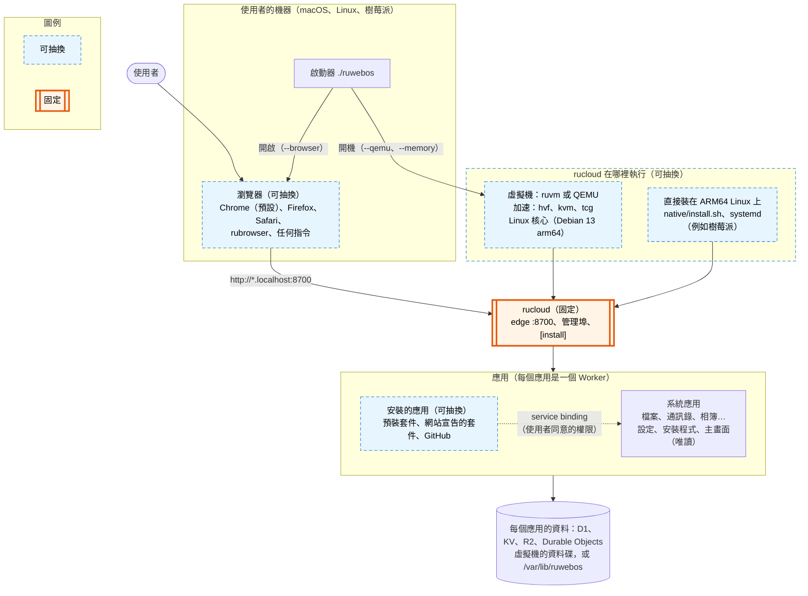
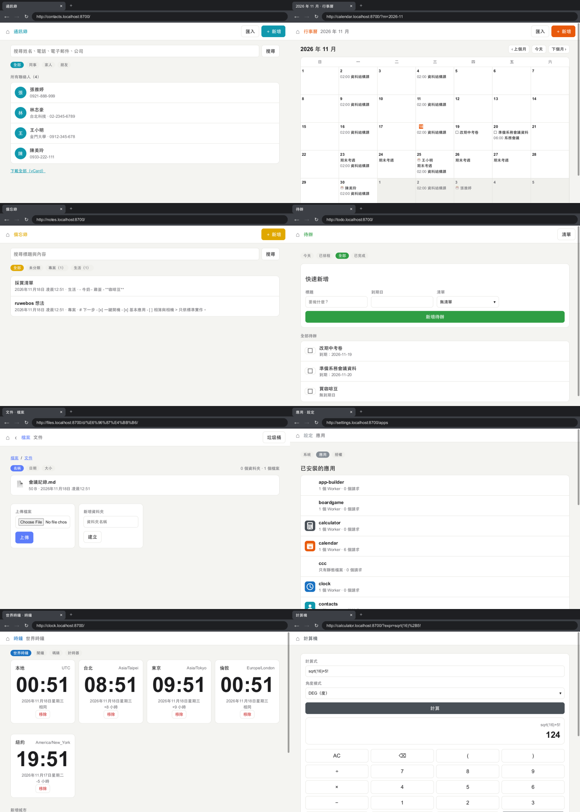

# ruwebos

以瀏覽器為介面的作業系統，有完整的圖形介面，適合平板、手機與桌機。

## 為什麼做這個

ruwebos 是在 AI 的協助下做出來的：一個自己的瀏覽器（rubrowser）、在本機重現 Cloudflare 基礎建設的 rucloud、一個自己的虛擬機（ruvm），再加上 Linux（Debian），組成一個類似平板、手機作業系統的系統。

它的特色是**介面就是瀏覽器**，所以：

* **能發佈到 Cloudflare 的網站應用，就能安裝到這個系統**。不必像 iOS、Android 那樣，只能透過平台自己的軟體商店；網站在網頁裡宣告套件，或給一個 GitHub 儲存庫，就能安裝（[doc/install.md](doc/install.md)）。
* **一份程式碼，同時用在網站、手機、平板、桌機**。不必為了手機版、桌機版各開一個專案：應用寫成可以發佈到 Cloudflare 的形式、在 rucloud 上測試通過，就能同時發佈到這些地方。
* **整個系統都是開放原始碼**：從瀏覽器、應用伺服器到虛擬機，每一層都看得到、改得到；系統碟裡每個套件的授權都列得出來。

一開始使用者介面用的是自己做的 rubrowser，但它對大型網站（GitHub、YouTube 等）的支援一直不夠完整。後來想通了：沒有必要堅持用自己的瀏覽器。既然應用都是標準的網頁，就讓瀏覽器可以抽換；換上 Chrome 這類成熟的瀏覽器之後，整個系統就完整了。rubrowser 仍然保留，用來研究與驗證網頁標準。

同樣的道理，虛擬機也可以抽換（ruvm 或 QEMU），甚至不用虛擬機，直接裝在 ARM64 的 Linux 上（例如樹莓派；目前在 Docker 的 Debian 容器裡測試通過，還沒在樹莓派實機上試過，見 [doc/native.md](doc/native.md)）。

目前的限制：安裝的應用能用的 Cloudflare 服務是 D1、KV、R2、Durable Objects 與排程（cron）；Workers AI、Queues、Email 等還不能用，需要先建置（npm）的專案也要先處理。網路上現成的候選應用見 [doc/cloudflare-apps.md](doc/cloudflare-apps.md)。

## 組成

ruwebos 把幾個獨立的專案串成一個系統，使用者看到的只有瀏覽器。除了 rucloud，其他部分都可以抽換：

| 部分 | 預設 | 可以換成 |
|---|---|---|
| 瀏覽器 | Chrome（沒有就用 rubrowser） | Firefox、Safari、[rubrowser](https://github.com/ccc-claude-opus/rubrowser)、任何指令（`--browser`） |
| 虛擬機 | [ruvm](https://github.com/ccc-claude-opus/ruvm)：macOS 用 Hypervisor.framework（`-accel hvf`）、ARM Linux 用 KVM，其他平台用直譯器 | QEMU（`--qemu`）；或不用虛擬機，直接裝在 ARM64 Linux 上（[doc/native.md](doc/native.md)） |
| Linux（Debian 13 arm64） | 核心、檔案系統、網路；使用者不直接接觸 | 一般的 ARM64 Linux |
| [rucloud](https://github.com/ccc-claude-opus/rucloud) | 應用伺服器：每個應用是一個 Cloudflare Workers 式的 Worker，資料放 D1、KV、R2、Durable Objects | **固定**（應用都依它的 Workers 相容 API 寫成） |
| 應用 | 系統應用與預裝套件 | 安裝其他套件、移除預裝的（[doc/install.md](doc/install.md)） |

本 repo 負責整合：系統映像的建置、一鍵啟動器、主畫面、系統應用與安裝程式。

## 架構



使用者只透過瀏覽器使用系統：所有應用都在 `http://<名稱>.localhost:8700/`，由 rucloud 提供。rucloud 跑在虛擬機裡（啟動器把主機的 8700 埠轉進去），或直接裝在 Linux 上（[doc/native.md](doc/native.md)）。安裝的應用只能透過使用者同意的權限（service binding）存取系統應用的資料。


## 快速開始

需要：Apple Silicon 的 macOS（或 ARM Linux 加 KVM；其他平台可用較慢的直譯器）、Docker、Rust 與 [cargo-zigbuild](https://github.com/rust-cross/cargo-zigbuild)。四個 repo 放在同一層：

```bash
git clone https://github.com/ccc-claude-opus/ruvm
```

```bash
git clone https://github.com/ccc-claude-opus/rucloud
```

```bash
git clone https://github.com/ccc-claude-opus/rubrowser
```

```bash
git clone https://github.com/ccc-claude-opus/ruwebos
```

建置 ruvm（macOS 上還要簽署 Hypervisor 權限）與 rubrowser：

```bash
(cd ruvm && cargo build --release && tools/hvf-sign.sh)
```

```bash
(cd rubrowser && cargo build --release)
```

要播放影音，另外裝 FFmpeg 8（例如 `brew install ffmpeg`）；啟動器第一次執行時會自動建一個有影音功能的 rubrowser（`--features media`，放在 `rubrowser/target/media`，約 3～4 分鐘）。

下載 Debian 13 的 arm64 核心，並產生 ruvm 的 initramfs（載入 virtio 與 ext4 模組、掛載系統碟）：

```bash
(cd ruvm && tools/linux/fetch-debian.sh arm64 && tools/linux/mkroot.sh arm64)
```

然後一個指令開機：

```bash
cd ruwebos && ./ruwebos
```

第一次會先建系統碟（`image/build.sh`，約半分鐘）。之後從關機到 rubrowser 顯示主畫面約 5 秒；關掉 rubrowser 或按 Ctrl-C 就正常關機。

| 指令 | 作用 |
|---|---|
| `./ruwebos` | 開機並用瀏覽器開主畫面 `http://localhost:8700/`（預設 Chrome，沒有就用 rubrowser；結束瀏覽器就關機） |
| `./ruwebos --headless` | 只開機，用任何瀏覽器開 `http://localhost:8700/`，Ctrl-C 關機 |
| `./ruwebos --screenshot home.png [網址]` | 開機、截圖（Chrome 或 Firefox 的 headless 模式，否則 rubrowser）、關機 |
| `./ruwebos --test` | 開機、跑每個應用的測試（`apps/*/test.mjs`）、關機 |
| `./ruwebos --accel tcg` | 指定加速器（預設依序 hvf → kvm → tcg） |
| `./ruwebos --qemu` | 改用 QEMU（`qemu-system-aarch64` 的 `virt` 機型）開同一份核心、系統碟與資料碟；可以和其他選項一起用 |
| `./ruwebos --memory 8192` | VM 的記憶體（MB，預設 2048） |
| `./ruwebos --browser rubrowser` | 換瀏覽器：`chrome`、`firefox`（各用 `out/` 裡自己的設定檔，不動到你平常用的）、`safari`、`rubrowser`，或任何指令（最後會加上網址） |
| `./ruwebos --keyboard always` | rubrowser 的虛擬鍵盤：`auto`（用手指點輸入框時出現，預設）、`always`、`never` |
| `image/build.sh` | 重建系統碟 `out/system.ext4`（資料碟 `out/data.ext4` 不受影響） |

應用的網址是 `http://<名稱>.localhost:8700/`。

應用都是標準的網頁，瀏覽器只是用戶端，所以可以抽換：日常使用建議用成熟的瀏覽器（Chrome、Firefox、Safari 都能直接開 `*.localhost`），rubrowser 是本專案自己的瀏覽器，用來研究與驗證標準相容性。rubrowser 獨有的功能在其他瀏覽器裡改用系統的方式：網頁宣告的套件 → 在安裝程式貼上網址安裝；加到主畫面 → 安裝程式的「我的最愛」；虛擬鍵盤 → 作業系統或瀏覽器自己的。Chrome 以一般的視窗開啟（有上一頁、網址列、分頁）；在 macOS 上關掉視窗後 Chrome 還在執行，要結束 Chrome（⌘Q）才會關機。

系統碟不綁定 ruvm：核心與磁碟都是標準的 ARM64 Linux 與 virtio 裝置，QEMU 也能開（initramfs 只有 virtio-mmio 的驅動，所以 QEMU 用 `virtio-*-device`）。2026-11-19 在 iMac M3 上，ruvm 與 QEMU（`-accel hvf`，8 GB）都通過全部 14 個應用的測試；從啟動到可以使用，ruvm 約 2.0 秒、QEMU 約 1.1 秒。QEMU 模擬的樹莓派 4（`raspi4b`）固定 2 GB 記憶體、只能軟體模擬，所以不拿來測；在樹莓派上直接安裝的計畫見 [doc/todo.md](doc/todo.md)。

| 基本應用（本 repo 的 `apps/`） | |
|---|---|
| 檔案 `files` | 資料夾、上傳、預覽、垃圾桶 |
| 通訊錄 `contacts` | 群組、我的最愛、vCard 匯入匯出 |
| 行事曆 `calendar` | 月曆、重複行程、生日與待辦、iCalendar 匯入匯出 |
| 備忘錄 `notes` | Markdown、資料夾、搜尋 |
| 待辦 `todo` | 清單、期限、重複事項 |
| 計算機 `calculator` | 一般與科學運算 |
| 時鐘 `clock` | 世界時鐘、鬧鐘、碼錶、計時器 |
| 相簿 `photos` | 依拍攝日期整理、EXIF、相簿、最愛 |
| 音樂 `songs` | 歌曲、專輯、演出者、播放清單、播放器 |
| 影片 `videos` | 清單、記住看到哪裡 |
| 天氣 `weather` | 現在、24 小時與一週預報（Open-Meteo） |
| 地圖 `map` | 釘選地圖（Leaflet + OpenStreetMap） |
| 設定 `settings` | 系統資訊、應用、授權清單 |
| 安裝程式 `installer` | 安裝、更新、移除應用與它們的權限；主畫面的我的最愛 |

## 安裝應用

網站在網頁裡宣告套件（`<link rel="ruwebos-app" href="app.tar.gz">`）時，rubrowser 的網址列旁會出現「安裝」；也可以在安裝程式貼上套件或 GitHub 儲存庫的網址。安裝的應用在 `http://<名稱>.localhost:8700/` 執行、資料在資料碟，要讀寫「檔案」、讀系統資訊、連網際網路都要使用者同意（安裝時，或應用需要時再問），之後可以在安裝程式收回。只有網址的網站可以加到主畫面的「我的最愛」。設計與給應用開發者的說明見 [doc/install.md](doc/install.md)。

rucloud 的範例應用 myshop、friendbook、markpedia、music、boardgame、webportal、ccc 是預裝的套件：第一次開機時裝好，可以像其他應用一樣移除；app-builder 仍是系統應用。




## 系統碟與資料碟

* `out/system.ext4`：Debian 13 + Node 24 + rucloud + 預裝應用 + init，唯讀（開機時以 snapshot 掛載），更新時整顆替換。
* `out/data.ext4`：rucloud 的資料（每個應用的 D1、KV、R2），重開機後還在；第一次開機時自動格式化。
* 系統時區取自主機（啟動器經核心命令列傳入）。

映像裡每個套件的授權列在 [doc/licenses.md](doc/licenses.md)（由 `image/build.sh` 產生）。

## 文件

* [doc/plan.md](doc/plan.md)：整體規劃與五個階段
* [doc/stage1.md](doc/stage1.md)：階段 1（一鍵啟動的系統映像）的設計與實測數字
* [doc/apps.md](doc/apps.md)：基本應用（檔案、通訊錄、相機、相簿……）的規劃
* [doc/batch1.md](doc/batch1.md)、[doc/batch2.md](doc/batch2.md)：第 1、2 批基本應用的功能、標準與實測結果
* [doc/install.md](doc/install.md)：軟體安裝（套件、權限、安裝程式），以及怎麼寫可以安裝的應用
* [doc/native.md](doc/native.md)：不用虛擬機，直接安裝在 Linux 上（`native/`）
* [doc/todo.md](doc/todo.md)：待辦與已知問題

開發應用時可以不經 VM，直接在主機上跑：先 `node image/gen-home.mjs ../rucloud` 與 `node image/gen-packages.mjs ../rucloud`，再 `rucloud serve $PWD/apps/dev.toml`（主畫面 `http://localhost:8790/`），測試用 `node apps/test.mjs http://localhost:8790`。

## 授權

MIT。系統碟裡每個套件的授權見 [doc/licenses.md](doc/licenses.md)。

本 repo 沒有包含也沒有連結 FFmpeg。有影音功能的 rubrowser 會連結機器上的 FFmpeg：自己建置使用沒有額外義務；如果要**散布**這樣的 rubrowser 執行檔，就要遵守那份 FFmpeg 的授權——Homebrew 的 FFmpeg 是 GPL 版（含 x264），執行檔要依 GPL 條款散布；改用只含 LGPL 部分的 FFmpeg（不加 `--enable-gpl`，播放只需要它內建的解碼器）並動態連結，就能照 MIT 散布，附上 FFmpeg 的授權聲明與原始碼取得方式即可。ruwebos 與 rubrowser 的原始碼都維持 MIT。
