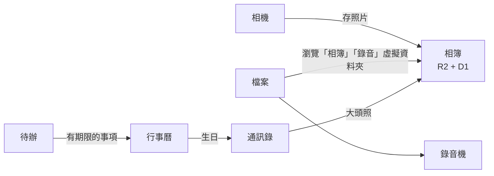

# 基本應用規劃：檔案、通訊錄、相機、相簿……

目標：讓 ruwebos 有手機與桌機都會用到的基本應用。每個應用都是一個 rucloud 應用（Worker + 靜態檔案），資料存在資料碟，和[階段 1](stage1.md)的預裝應用一樣由 `rucloud serve` 執行、從主畫面開啟。

這份文件先決定**要做哪些應用、分幾批、各需要什麼**；做法的細節在每一批開工時補上。

**進度**：第 1 批已完成，見 [batch1.md](batch1.md)。

## 1. 現況盤點

### rucloud 能提供的（夠用）

| 需要 | rucloud 的對應 |
|---|---|
| 結構化資料（聯絡人、行程、備忘錄） | D1（SQLite） |
| 檔案、照片、錄音 | R2（含 range 讀取、multipart） |
| 設定、小資料 | KV |
| 即時同步、鬧鐘排程 | Durable Objects（alarm、WebSocket）、Cron Triggers |
| 應用之間互相呼叫 | Service bindings（`env.PHOTOS.fetch`、RPC） |
| 全文／語意搜尋 | Vectorize、D1 FTS |
| 對外抓資料（天氣） | `fetch`（VM 已能上網） |

### rubrowser 缺的（決定了先後順序）

檢查 rubrowser 原始碼的結果：

| Web 標準 | 現況 | 哪些應用需要 |
|---|---|---|
| 表單、`fetch`、`localStorage`、`<canvas>`、`toBlob` | 有 | 全部 |
| `<input type="file">` 的檔案選擇 | 只畫出外觀，不能選檔 | 檔案上傳、相簿匯入、通訊錄匯入 |
| `File`、`FileReader`、`Blob.arrayBuffer()`、`URL.createObjectURL` | 沒有或只是空殼 | 上傳、預覽 |
| `multipart/form-data`（RFC 7578） | `FormData` 被送成 urlencoded | 上傳 |
| 下載（`Content-Disposition: attachment`、`<a download>`） | 未確認 | 匯出 vCard、iCalendar、檔案 |
| `<audio>`、`<video>` | 有（`media` feature，FFmpeg） | 音樂、影片、錄音播放 |
| WebSocket（RFC 6455） | 沒有 | 訊息、多裝置即時同步 |
| Notifications API | 沒有 | 鬧鐘、行事曆提醒 |
| Media Capture（`getUserMedia`） | 沒有 | 相機、錄音機 |
| Touch / Pointer Events | 部分（pointer） | 手機版面（階段 3） |

所以第一批先做**只靠表單與 `fetch` 就能完整使用**的應用，同時在 rubrowser 補檔案相關的標準；相機、錄音、鬧鐘放在 rubrowser 補齊對應標準之後。

## 2. 要加入的應用

不做：電話與簡訊（ruwebos 沒有行動網路模組）；瀏覽器（rubrowser 本身就是）。

| 批次 | 應用 | 功能 | 資料 | 需要 rubrowser 補的 |
|---|---|---|---|---|
| **1** | **檔案**（檔案總管） | 資料夾瀏覽、新增資料夾、改名、搬移、刪除（先進垃圾桶）、預覽文字、圖片、音訊、影片、依類型與日期排序 | R2（內容）+ D1（目錄樹、垃圾桶） | 上傳要等第 2 批的檔案標準；先能管理、預覽與下載 |
| 1 | **通訊錄** | 聯絡人（多電話、多 email、地址、生日、群組、照片）、搜尋、我的最愛；匯入匯出 vCard（RFC 6350） | D1；照片在 R2 | 匯入要檔案選擇 |
| 1 | **行事曆** | 月／週／日檢視、重複規則（RRULE）、提醒時間；匯入匯出 iCalendar（RFC 5545） | D1 | 提醒要 Notifications |
| 1 | **備忘錄** | Markdown 筆記、資料夾與標籤、全文搜尋、釘選 | D1（FTS5） | — |
| 1 | **待辦** | 清單、期限、完成、重複；和行事曆共用日期 | D1 | — |
| 1 | **計算機** | 一般與工程模式、歷史紀錄 | 只在頁面（`localStorage`） | — |
| 1 | **時鐘** | 世界時鐘、碼錶、計時器；鬧鐘先只能在頁面開著時響 | KV | 背景鬧鐘要 Notifications |
| 1 | **地圖** | 釘選、清單、搜尋地點；從 rucloud 的 `apps/map` 搬來，套上共用樣式與 manifest | D1 | 底圖圖磚目前畫不出來（rubrowser 待查） |
| 1 | **設定** | 已安裝的應用、資料碟用量、系統版本、外觀（深淺色）、時區與語言、授權清單 | 讀 rucloud 管理埠（只在 VM 裡）、KV | — |
| **2** | **相簿** | 照片與影片的格狀檢視、依日期分組、相簿、我的最愛、EXIF（拍攝時間、地點）、縮圖 | R2（原檔與縮圖）+ D1（索引、EXIF） | 檔案選擇、`File`、multipart 上傳 |
| 2 | **音樂** | 曲目、專輯、播放清單、背景播放 | R2（range 讀取）+ D1 | 上傳；`<audio>` 已有 |
| 2 | **影片** | 影片清單、續播位置 | R2 + D1 | 上傳；`<video>` 已有 |
| 2 | **天氣** | 現在與一週預報、多個城市 | KV（快取）；資料來自公開 API（例如 Open-Meteo，CC BY 4.0，需標示來源） | — |
| **3** | **相機** | 拍照、錄影，存進相簿 | 透過 service binding 存到相簿 | `getUserMedia`、`<video>.srcObject`、canvas 擷取 |
| 3 | **錄音機** | 錄音、清單、播放、改名 | R2 + D1 | `getUserMedia`（音訊）、`MediaRecorder` |
| 3 | 時鐘的**背景鬧鐘**、行事曆**提醒** | 到時間由系統通知 | Durable Object alarm → 外殼顯示通知 | Notifications API |
| 之後 | 訊息、郵件、應用商店、全系統搜尋 | 見[規劃](plan.md)階段 3～5 | — | WebSocket、帳號 |

已經有的預裝應用照舊保留：琴鍵實驗室（music，樂理學習，與上面的「音樂」播放器不同）、Markpedia、棋藝軒等。

## 3. 共同的設計

### 放在哪裡

基本應用放在本 repo 的 `apps/<名稱>/`（rucloud repo 的 `apps/` 是範例與展示用）。`image/build.sh` 把兩邊都裝進系統碟（本 repo 的在 `/opt/ruwebos/apps`，rucloud 的範例在 `/opt/ruwebos/examples`），`image/rucloud.toml` 各加一個 `[[app]]`。

| 共用檔案 | 作用 |
|---|---|
| `apps/_shared/lib.js` | 伺服器端：`html` 樣板（自動跳脫）、`page()` 版面、`redirect()`、`readForm()`、時區工具、錯誤頁 |
| `apps/_shared/markdown.js` | 安全的 Markdown 轉 HTML（備忘錄、檔案預覽、授權清單） |
| `apps/_shared/ui.css`、`enhance.js` | 共用樣式與漸進增強；`gen.mjs` 把它們包成 `assets.js`，每個應用的 Worker 在自己的網址提供 `/_ui/ui.css`、`/_ui/enhance.js` |
| `apps/dev.toml` | 在主機上直接跑全部應用（不經 VM）：`rucloud serve $PWD/apps/dev.toml`，主畫面 `http://localhost:8790/` |
| `apps/test.mjs` | 跑每個應用的 `test.mjs`：`node apps/test.mjs http://localhost:8790`；`./ruwebos --test` 在 VM 裡跑 |

應用用 `import … from '../../_shared/lib.js'` 取用共用程式；rucloud 的沙箱只准讀應用自己的資料夾，所以 `rucloud.toml` 給每個應用 `allow_read = [".../apps/_shared"]`。

### 應用之間的資料

每個應用的資料由 rucloud 隔離（各自的 D1、R2），需要共用時走 **service binding**，像手機的「媒體庫」與「分享」：

* 「檔案」是使用者看到的總目錄：自己的 R2 之外，用 service binding 把相簿、錄音機、音樂顯示成虛擬資料夾。
* 每個應用在自己的 `wrangler.jsonc` 宣告需要哪些 binding，外人一看就知道它能碰到誰的資料（之後階段 4 的權限從這裡來）。

### 畫面與相容性

* **表單為基礎、`fetch` 做互動、WebSocket 只用在需要推送的地方**（比較見下一節）。
* 共用一份樣式（`apps/_shared/ui.css`：顏色、字級、清單、按鈕、深色模式），建置時複製進每個應用；版面一開始就同時照顧桌機（寬）與手機（390 px 寬）。
* 每個應用附 `manifest.webmanifest`（名稱、圖示、主題色）。主畫面改成**建置時從各應用的 manifest 產生**，不再手寫；階段 3 的「安裝」也從這裡接上。
* 只依 Web 標準實作，不針對 rubrowser 做特例；rubrowser 缺的部分在 rubrowser repo 依規格補。

### 表單、fetch、WebSocket 的比較

三種都是「瀏覽器和 rucloud 交換資料」的方式，差在誰發起、畫面怎麼更新：

| | HTML 表單（伺服器產生頁面） | `fetch`（JavaScript 更新部分畫面） | WebSocket |
|---|---|---|---|
| 怎麼運作 | 送出 → 伺服器處理 → 回整頁新的 HTML（POST 後轉址） | JavaScript 送請求、拿回 JSON 或 HTML 片段，只改需要變的地方 | 開一條一直連著的雙向連線，伺服器可以主動送資料 |
| 互動感 | 每個動作整頁重畫，捲動位置與輸入中的內容會重來 | 和一般 App 一樣，不閃、不跳 | 和 `fetch` 一樣，另外能即時收到別人／別台裝置的變更 |
| 伺服器主動通知 | 不行 | 不行（只能定時輪詢） | 可以 |
| 網址、上一頁、書籤 | 天生就對 | 要自己用 History API 維持 | 要自己維持 |
| 沒有 JavaScript 或 JS 出錯時 | 照常可用 | 壞掉 | 壞掉 |
| rubrowser 現況 | 可用 | 可用（`fetch`、DOM 都有） | **還沒有**，要先補 |
| rucloud 端 | 一般 Worker | 一般 Worker | 要 Durable Object 管連線、斷線重連 |
| 程式量 | 最少 | 中 | 最多 |

結論：只用表單，互動性確實比較差；只用 `fetch`，rubrowser 的 JavaScript 有缺漏時整個應用不能用。所以採**漸進增強**：

1. 每個操作先寫成一般的 `<form>`，伺服器回完整頁面——這是保底，也讓網址、上一頁都正確。
2. 共用一支小腳本（`apps/_shared/enhance.js`，自己寫，約一百行）：攔下表單送出，改用 `fetch` 送，伺服器看到 `Accept` 標頭就只回要更新的那一段 HTML，腳本把它換進頁面並更新網址。使用者看到的是 `fetch` 的互動性；腳本失敗時自動退回整頁。
3. 本來就只能在頁面上做的（計算機、碼錶、計時器、行事曆拖曳）直接用 JavaScript 寫。
4. WebSocket 等 rubrowser 支援後，只用在真的需要伺服器推送的地方：多裝置即時同步、訊息、提醒。第 1 批的應用都是自己改自己的資料，不需要。

### 資料可以帶走

* 通訊錄匯出 vCard，行事曆匯出 iCalendar，備忘錄匯出 Markdown，檔案與照片就是原檔。之後可再加 CardDAV（RFC 6352）、CalDAV（RFC 4791），讓其他裝置同步。
* 全部存在資料碟，重開機與更新系統碟都不受影響。

### 帳號

先單一使用者、不登入（只能從本機經 hostfwd 連進來）。階段 4 加帳號時，每個應用的資料表多一個使用者欄位即可，所以資料表一開始就預留 `owner`。

### 授權

應用本身 MIT；只用自己寫的程式碼或授權清楚的函式庫（例如 EXIF 解析自己寫，不夾帶授權不明的圖示）。圖示用文字與 CSS，或授權為 MIT／CC0 的圖示集，並列進 `licenses.md`。

### 測試

每個應用附一個 API 測試（`apps/<名稱>/test.mjs`，Node 的 `fetch`，在主機上經 hostfwd 打 VM 裡的應用），加上 rubrowser 截圖；`./ruwebos --test` 開機、跑全部、關機。

## 4. 建議的順序

1. **共同基礎**：`apps/_shared/ui.css`、`enhance.js`、manifest、主畫面改為自動產生、`--test`。
2. **第 1 批**：檔案（管理、預覽、下載）→ 通訊錄 → 行事曆 → 備忘錄 → 待辦 → 計算機 → 時鐘 → 地圖 → 設定。
3. **同時在 rubrowser 補**：`<input type="file">` 與檔案選擇對話框、`File` / `FileReader` / `Blob.arrayBuffer()`、`URL.createObjectURL`、multipart 送出、下載存檔。完成後檔案與通訊錄的上傳、匯入就能用。
4. **第 2 批**：相簿 → 音樂 → 影片 → 天氣。
5. **rubrowser 補** `getUserMedia`（macOS 用 AVFoundation、Linux 用 V4L2）、`MediaRecorder`、Notifications、WebSocket。
6. **第 3 批**：相機 → 錄音機 → 背景鬧鐘與提醒。

風險：攝影機與麥克風現在由主機上的 rubrowser 直接存取；到階段 2（rubrowser 在 VM 裡）時，ruvm 還需要把主機的攝影機與麥克風傳進 VM（例如 virtio 的影音裝置），這部分到時再規劃。

## 5. 已決定的事（2026-11-18）

| 問題 | 決定 |
|---|---|
| 第 1 批的範圍與順序 | 檔案、通訊錄、行事曆、備忘錄、待辦、計算機、時鐘、設定，加上地圖（從 rucloud 的 `apps/map` 搬來） |
| 應用放在哪個 repo | ruwebos 的 `apps/`；rucloud 的 `apps/` 保留給範例 |
| 畫面做法 | 表單保底 + `fetch` 局部更新（漸進增強）；WebSocket 只用在需要伺服器推送的地方（見上面的比較） |
| 天氣的資料來源 | Open-Meteo（免金鑰，資料 CC BY 4.0，頁面標示來源） |
| rubrowser 的檔案標準 | 待確認：ruwebos 的應用照標準寫上傳（`<input type="file">` + multipart 表單），先用 curl 與其他瀏覽器測；rubrowser 另一條工作依規格補這些功能，補好後直接能用，兩邊不互相等 |
