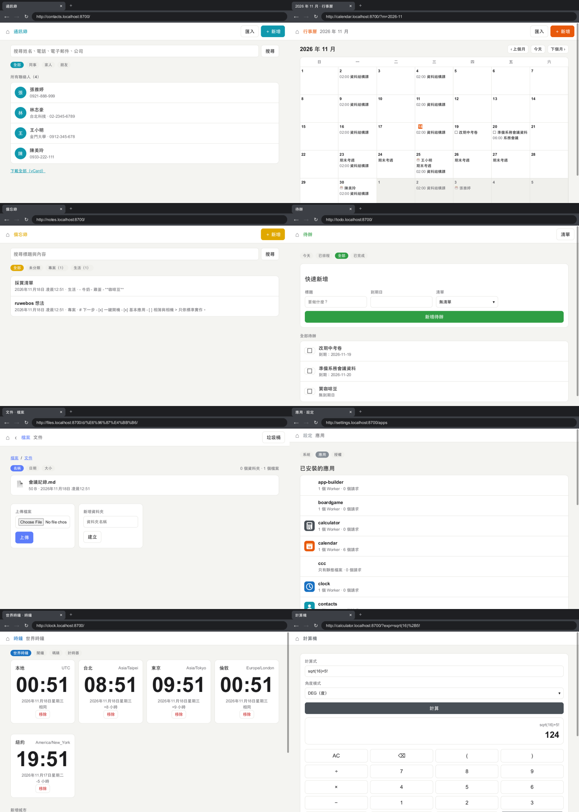

# 第 1 批基本應用

依[基本應用規劃](apps.md)完成的第 1 批：檔案、通訊錄、行事曆、備忘錄、待辦、計算機、時鐘、地圖、設定。都在本 repo 的 `apps/`，裝在系統碟的 `/opt/ruwebos/apps`，從主畫面開啟。

## 結果（2026-11-18，iMac M3，`-accel hvf -smp 4`，rubrowser release 版）

| 項目 | 結果 |
|---|---|
| `./ruwebos --test`（VM 裡，Node 24 + rucloud 沙箱開啟） | 9/9 個應用通過；連續跑兩次也通過（測試只清理自己建立的資料） |
| 啟動 → rucloud 就緒 | 1.56～1.92 秒（應用從 10 個變 18 個，Worker 都是第一次請求才啟動） |
| 啟動 → rubrowser 畫好主畫面 | 5.09、5.13、6.27 秒（完成條件 10 秒內） |
| 啟動 → rubrowser 畫好通訊錄（重開機後） | 3.63 秒 |
| 每個應用的測試時間 | 30～750 ms（行事曆與檔案最多，因為建立、匯入、清理的請求多） |
| 重開機後資料 | 第 3 次開機新增的聯絡人、行程、備忘錄、待辦、檔案，第 4 次開機都還在 |
| 系統碟 | 414 MB（檔案 280 MB），授權清單 327 列 |

## 各應用

| 應用 | 資料 | 功能 | 標準 |
|---|---|---|---|
| 檔案 `files` | R2 | 資料夾瀏覽與排序、上傳（multipart，多檔）、新增資料夾、改名、搬移、垃圾桶（還原、永久刪除、清空）、預覽文字／Markdown／圖片／音訊／影片、下載 | Range 請求（RFC 9110，206／416）；使用者的 HTML、SVG 一律以 `text/plain` 加 `Content-Security-Policy: sandbox` 送出 |
| 通訊錄 `contacts` | D1 | 搜尋、群組、我的最愛、多組電話與電子郵件、生日（可不含年份）；`/api/birthdays` 給行事曆 | vCard 4.0 匯出（RFC 6350，CRLF、75 位元組折行、跳脫），讀入也接受 3.0 |
| 行事曆 `calendar` | D1 | 月曆、單日行程、整天與跨日行程、重複（每天／每週指定星期／每月／每年、間隔、結束日）、在檢視者時區展開（跨日光節約時間仍是同一個鐘點）；顯示通訊錄的生日與待辦的期限 | iCalendar 匯出與匯入（RFC 5545：`VALUE=DATE`、`TZID`、浮動時間、RRULE 子集） |
| 備忘錄 `notes` | D1 | Markdown、資料夾、釘選、搜尋、下載 `.md` | 安全的 Markdown 轉換（先跳脫，只允許 http(s)／mailto／相對網址） |
| 待辦 `todo` | D1 | 今天／已排程／全部／已完成、清單、期限、重複（完成時自動產生下一次）；`/api/due` 給行事曆 | — |
| 計算機 `calculator` | — | 一般與科學運算（三角函數、對數、次方、階乘、角度／弳度）、鍵盤操作、歷史（`localStorage`）；沒有 JavaScript 時由伺服器計算 | 遞迴下降解析，不用 `eval` |
| 時鐘 `clock` | KV | 世界時鐘、鬧鐘（頁面開著時響）、碼錶、計時器 | 各城市的 UTC 偏移由伺服器算好，用戶端不依賴瀏覽器的時區資料 |
| 地圖 `map` | D1 | 從 rucloud 的 `apps/map` 搬來，加上 manifest、圖示與回主畫面的連結 | Leaflet 與 OpenStreetMap 圖磚在執行時從網路載入 |
| 設定 `settings` | — | 系統資訊（由 `/sbin/init` 寫入）、已安裝的應用（rucloud 管理埠）、授權清單 | — |

應用之間用 service binding 互相取資料：行事曆向通訊錄要生日、向待辦要有期限的事項；任一個不在時，行事曆照常可用。

## 系統的改變

* **共用程式**（`apps/_shared/`）：`lib.js`（`html` 樣板自動跳脫、版面、post/redirect/get、時區工具）、`markdown.js`、`ui.css`、`enhance.js`（漸進增強：連結與表單改用 `fetch` 換頁；新頁面有自己的 `<script>` 時改用一般導覽，因為 innerHTML 放進去的 script 不會執行）。
* **主畫面**由 `image/gen-home.mjs` 依各應用的 `manifest.webmanifest` 產生。
* **系統碟配置**：本 repo 的應用在 `/opt/ruwebos/apps`，rucloud 的範例在 `/opt/ruwebos/examples`。
* **init** 在第一次開機產生 rucloud 管理埠的 token（存在資料碟），把設定檔範本的 `@ADMIN_TOKEN@` 換掉後寫到 `/run/ruwebos/rucloud.toml`，並把系統資訊寫進設定應用的 env 檔。
* **開發**：`rucloud serve $PWD/apps/dev.toml` 在主機上直接跑全部應用（埠 8790），`node apps/test.mjs http://localhost:8790` 測試；`./ruwebos --test` 在 VM 裡測。
* **啟動器**優先使用 rubrowser 的 release 版。

## 怎麼做的

規格寫成文件後，先自己寫共用程式與「備忘錄」當範本，再把待辦、計算機、時鐘、通訊錄、行事曆、檔案交給便宜的模型（MiniMax M3.1 Flash）起草。待辦、計算機、時鐘的初稿可用（審查後修了布林值輸出、時鐘依賴瀏覽器時區、測試檔被截斷等問題）；通訊錄、行事曆、檔案的起草失敗（沒有寫出檔案、留下垃圾字元），改由我自己寫。全部應用都經過測試與 rubrowser 截圖確認。

## 已知問題與後續

* ~~rubrowser 的時區~~：已在第 2 批解決（rubrowser 補了 `Intl` 時區，ruwebos 加了系統時區，見 [batch2.md](batch2.md)）。
* ~~rubrowser 的 `table-layout: fixed`~~：已在 rubrowser 補上；行事曆的月曆維持 CSS grid。
* **rubrowser debug 版**只要頁面有 `<script>`，載入 JS 執行環境就要 15～20 秒；release 版約 1.5～3 秒。
* **檔案上傳、匯入 vCard／iCalendar 檔**要等 rubrowser 支援 `<input type="file">` 與 multipart（另一個 session 進行中）；貼上文字的匯入現在就能用，測試用 Node 的 `fetch` 驗證了 multipart 上傳。
* **rucloud 與 Node 25**：主機上的 Node 25 在權限模式下還要 `--allow-net`，rucloud 尚未支援，所以 `apps/dev.toml` 關掉沙箱；VM 裡的 Node 24 不受影響。
* 鬧鐘與行事曆提醒要在頁面開著時才會響；背景通知等 rubrowser 支援 Notifications API（第 3 批）。
