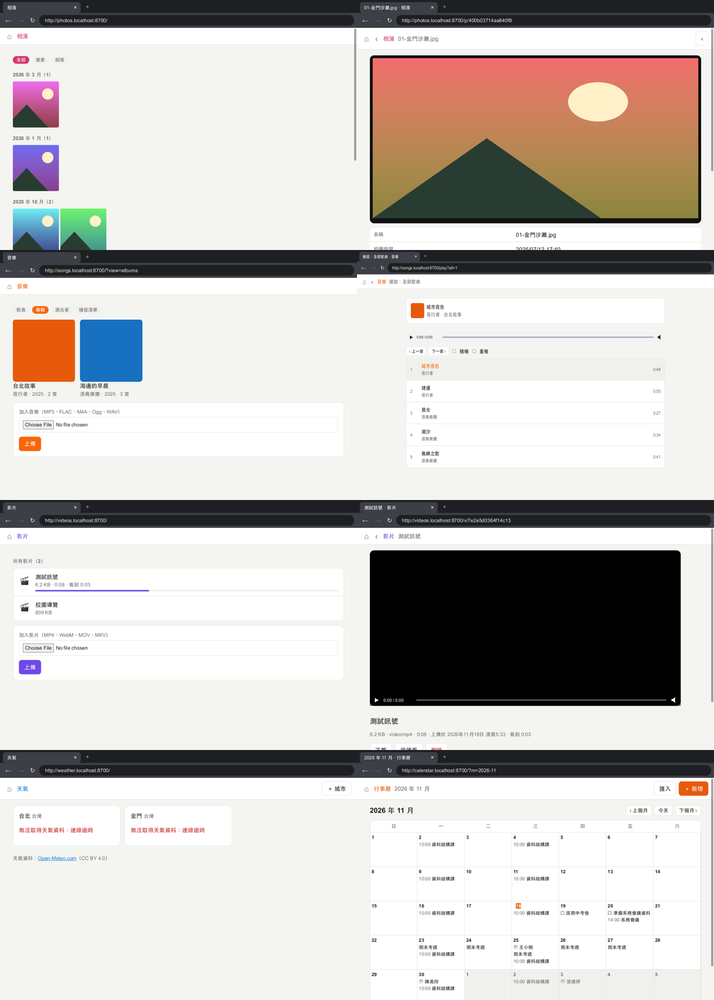
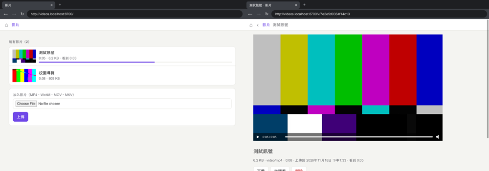
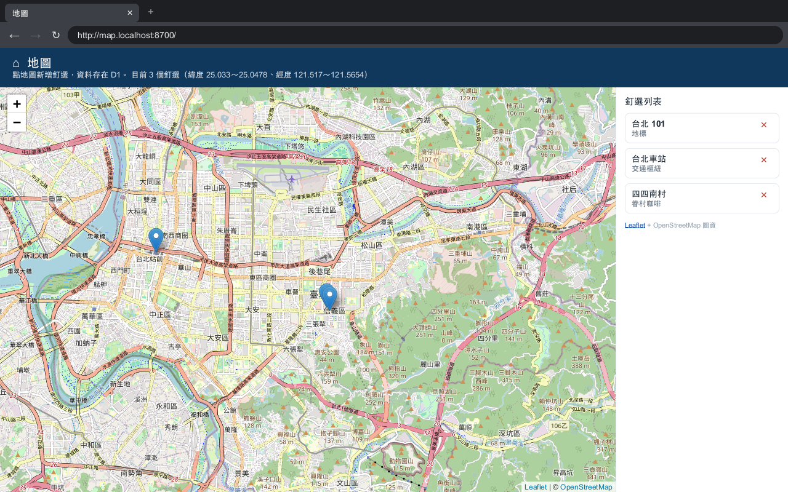

# 第 2 批基本應用

依[基本應用規劃](apps.md)完成的第 2 批：相簿、音樂、影片、天氣。同時在 rubrowser 補了 `Intl` 的時區與 zh-TW 日期格式、`table-layout: fixed`。

## 結果（2026-11-18，iMac M3，`-accel hvf -smp 4`，rubrowser release 版）

| 項目 | 結果 |
|---|---|
| `./ruwebos --test`（VM 裡，13 個應用） | 13/13 通過；連續跑兩次也通過 |
| 啟動 → rubrowser 畫好主畫面 | 4.84、5.55、5.65 秒（10 秒內） |
| 啟動 → rucloud 就緒 | 1.67～2.35 秒 |
| 啟動 → rubrowser 畫好音樂播放器 | 3.82 秒 |
| rubrowser 開各應用頁面（截圖模式） | 1.2～2.0 秒（天氣在 Open-Meteo 連不上時要等 10 秒逾時） |
| 相簿的縮圖 | rubrowser 在清單頁用 canvas 做好縮圖並送回伺服器（6 張裡 5 張在第一次截圖時完成） |

## 各應用

| 應用 | 資料 | 功能 | 標準 |
|---|---|---|---|
| 相簿 `photos` | R2（原檔、縮圖）+ D1 | 依拍攝月份分組、單張檢視（上一張／下一張）、EXIF 資訊（拍攝時間、相機、尺寸、GPS 連到 OpenStreetMap）、最愛、相簿（建立、加入、移出、改名、刪除）、下載、刪除；**從「檔案」應用加入照片**（service binding）；`/api/photos` | EXIF（CIPA DC-008／TIFF 6.0，含方向與 GPS）、JPEG／PNG／GIF／WebP 尺寸；縮圖由瀏覽器的 canvas 產生（漸進增強，失敗就顯示原檔） |
| 音樂 `songs` | R2（音檔、封面）+ D1 | 歌曲、專輯（封面）、演出者、播放清單；播放器（自動下一首、上一首／下一首、隨機、重複，不重新載入頁面）；編輯標籤、下載、刪除；`/api/tracks` | ID3v2.2／2.3／2.4 與 ID3v1（含 APIC 封面）、FLAC 的 STREAMINFO／VORBIS_COMMENT／PICTURE、MP4 的 mvhd／ilst（含 covr）、WAV；MP3 長度用 Xing 標頭或位元率估計 |
| 影片 `videos` | R2 + D1 | 清單、繼續觀看（進度條）、播放頁記住看到哪裡（每 5 秒、暫停、離開時回報）、從頭看、改名、下載、刪除 | 媒體片段 `#t=` 從上次的位置開始（瀏覽器不支援時腳本自己跳）；依檔頭判斷 MP4／QuickTime／Matroska／WebM／Ogg |
| 天氣 `weather` | KV | 多個城市的現在天氣、24 小時、7 天（日出日落、降雨機率）、搜尋並加入城市（Open-Meteo 地理編碼）；預報快取 30 分鐘，失敗時一分鐘內不重試 | Open-Meteo 的資料以 CC BY 4.0 授權，每一頁都標示來源；WMO 天氣代碼轉成中文 |

音樂、影片、相簿、檔案都用新的共用模組 `apps/_shared/r2.js` 送檔：單一 Range（206／416）、ETag／304、HEAD、下載檔名（RFC 6266／8187）。

## 系統時區

rubrowser 的 `document.cookie` 只存在頁面裡、不會送到伺服器，所以「用 cookie 告訴伺服器檢視者的時區」在 rubrowser 行不通。改成像手機一樣有**系統時區**：

1. 啟動器讀主機的時區（`TZ`，或 `/etc/localtime` 指向的 zoneinfo），以 `ruwebos.tz=Asia/Taipei` 放進核心命令列。
2. `/sbin/init` 從 `/proc/cmdline` 讀出來設成 `TZ`（只接受 IANA 名稱的字元），rucloud 與 Worker 都繼承。
3. 應用的 `tzOf()`：有 `tz` cookie 就用它（一般瀏覽器），否則用系統時區。設定頁會顯示系統時區。

測試工具固定送 `tz=UTC`，結果和系統時區無關。

## rubrowser 的改變（rubrowser repo）

* **時區**：`Date` 的本地時間與 `Intl.DateTimeFormat` 用主機的 IANA 時區；`timeZone` 選項接受主機時區資料庫裡的所有時區（用 `jiff` 讀 `/usr/share/zoneinfo` 或 macOS 的 `/var/db/timezone/zoneinfo`，MIT OR Unlicense），不認得的時區丟 `RangeError`；`Intl.supportedValuesOf('timeZone')`。新增 ABI 呼叫 `tz_local`、`tz_offset`、`tz_names`。web 版沒有時區資料庫，只有 UTC。
* **zh-TW 日期格式**：照 CLDR（`dateStyle`／`timeStyle`、`timeStyle` 的彈性時段「凌晨／清晨／上午／中午／下午／晚上」、「星期三」「週三」、`M/d（E）`、只有小時時的「時」），和 Node（ICU）的輸出逐字相同；en-US 的 full／long 日期加時間用「at」連接。
* `Intl.DateTimeFormat`、`NumberFormat`、`Collator` 可以不加 `new` 呼叫（ECMA-402）。
* **`table-layout: fixed`**（CSS 2.1 §17.5.2.1）：表格的寬度與第一列各格的寬度（px 或 %）決定欄寬，其餘欄平分，不看內容。
* 192 個測試全部通過，clippy 沒有警告。

## 影音的改善

| 項目 | 做法 | 結果 |
|---|---|---|
| rubrowser 能播影音 | 啟動器在有 FFmpeg 時自動建一個 `--features media` 的 rubrowser（`rubrowser/target/media`，約 3～4 分鐘，只建一次），之後優先用它 | 影片、音樂都經 HTTP 的 Range 從 VM 串流播放 |
| 從上次的位置繼續 | rubrowser 實作媒體片段 `#t=`（Media Fragments URI 1.0 的時間維度）；跳轉後立刻顯示那個時間點的畫面 | 測試頁 `#t=4` 顯示第 96 格（24 fps × 4 秒），`currentTime` 4.00 |
| 影片封面 | rubrowser 的 canvas `drawImage` 接受 `<video>`；影片播放頁在沒有封面時擷取一格（寬 320 px）送回伺服器 | 兩部示範影片都有了封面 |
| 播放前就知道長度與解析度 | 上傳時從容器讀：MP4／MOV 的 `mvhd`、`tkhd`，MKV／WebM 的 EBML（Segment Info、Tracks）；影片資料表改用 D1 migrations 加欄位 | ffmpeg 產生的 MP4（moov 在前與在後）、MOV、MKV、WebM 都讀對 |

授權：ruwebos 沒有包含或連結 FFmpeg；有影音功能的 rubrowser 連結機器上的 FFmpeg，散布那樣的執行檔時要遵守該 FFmpeg 的授權（見 README 的「授權」）。

## 試用時發現的問題（rubrowser）

試用時發現的問題，都在 rubrowser 依標準修正：

| 問題 | 原因 | 修正 |
|---|---|---|
| 地圖只有灰底與標記 | ① rubrowser 沒有對 `` 送 `load`／`error` 事件，Leaflet 等不到圖磚載好，圖磚一直是 `visibility: hidden`；② rubrowser 不送 `Referer`，OpenStreetMap 的圖磚伺服器回傳「Access blocked」 | 圖片解碼後送 `load`（失敗送 `error`），加上 `complete`、`naturalWidth`、`naturalHeight`；請求依預設的 `strict-origin-when-cross-origin` 送 `Referer` |
| 網頁文字不能選、Cmd-C 沒作用 | 只有輸入框有選取與剪貼簿 | 拖曳選取、雙擊選字、Shift 點擊延伸、Cmd-A 全選、Cmd-C 複製（多行用換行接起來） |
| 沒有右鍵選單 | 沒有實作 | 右鍵或 macOS 的 Ctrl＋點擊：複製、全選、上一頁、下一頁、重新載入；連結與圖片另有開啟、在新分頁開啟、複製網址、下載；輸入框有剪下、複製、貼上、全選；網頁取消 `contextmenu` 事件時不顯示 |
| Cmd-C 等快捷鍵在視窗裡沒作用（右鍵選單的複製可以） | 用注音等非拉丁輸入法時，C 鍵的字元是「ㄏ」，rubrowser 認不出 Cmd+C | 按著 Cmd／Ctrl 而字元不是拉丁字母時，改用按鍵在美式鍵盤上的位置判斷（瀏覽器的通例） |
| 地圖按住拖不動 | rubrowser 沒送 `mousemove`／Pointer Events，且滑鼠事件的 `which` 是 0（Leaflet 用 `which === 1` 判斷左鍵） | 依 UI Events／Pointer Events 送 `pointerdown`→`mousedown`、`pointermove`→`mousemove`、`pointerup`→`mouseup`，`which = button + 1`、`buttons`；`selectstart` 被取消或 `user-select: none` 時拖曳不選字 |
| webportal 點分類不會進去 | 沒有 `location.hash` 的 setter 與 `hashchange` 事件 | 補上；上一頁／下一頁在同一頁的 # 之間移動時送 `popstate` 與 `hashchange` |
| 琴鍵實驗室沒有聲音 | 沒有 Web Audio API（琴鍵也用 `pointerdown`） | Web Audio 的子集：`AudioContext`、`OscillatorNode`、`GainNode`、`AudioParam` 排程（set、線性／指數漸變、setTargetAtTime、cancel）、`ended`；有影音功能時由 cpal 輸出到喇叭 |
| 關分頁後網址列還是舊分頁的網址；視窗較矮時按 Cmd-L 會當掉 | 網址列有焦點時不更新；畫布外的矩形取交集後的起點超出陣列 | 切換／關閉分頁時網址列換成新分頁的網址；不相交的矩形交集為空 |
| 棋藝軒（boardgame）畫面出不來 | 沒有 `HTMLIFrameElement` 等元素介面（`instanceof` 丟錯）；沒有 `WebSocket` | 依 HTML 補上各元素介面與 `namespaceURI`；實作 `WebSocket`（RFC 6455，`ws:`／`wss:`、文字與二進位訊息、子協定、關閉碼，每條連線一個執行緒，用 tungstenite） |
| 地圖不能用滾輪縮放 | 沒有 `WheelEvent` 的 `deltaY`，`window.onwheel` 不存在（Leaflet 以 `'onwheel' in window` 判斷） | 先送可取消的 `wheel` 事件（含 `deltaX`／`deltaY`）再捲動；`Window` 補上各事件處理屬性 |
| 上一頁回到網頁開頭 | 歷史記錄沒有存捲動位置 | 每筆歷史記錄記住離開時的位置，上一頁／下一頁／重新載入時還原（HTML 的 scroll restoration `auto`），頁面還在長大時一直保持，直到使用者自己捲動 |
| Markpedia 一直「載入中…」 | 每頁都先載入 Mermaid（約 3 MB），在 rubrowser 的 JS 引擎裡要跑將近 20 秒，超過單次執行的時間上限 | Markpedia（rucloud repo）改成頁面有 mermaid 圖時才載入；rubrowser 補上 `document.compatMode` |
| 中文網址連到 GitHub Pages 出現「Whoa there!」 | 網址的路徑直接送出 UTF-8 位元組 | 依 URL Standard 對路徑、查詢、片段做百分比編碼 |
| ruby 注音顯示在字的右邊 | 沒有 ruby 排版 | `display: ruby`／`ruby-text`：注音置中放在本字上方，一個 `<ruby>` 可有多組，`<rp>` 隱藏 |
| Google 搜尋框不能打字 | ① 沒有 `CSS.supports`；② `focus()` 是空的、`document.activeElement` 永遠是 body；③ 不支援 `pointer-events: none`，「AI 模式」按鈕放大的動畫層蓋住搜尋框、搶走點擊 | 補上 `CSS.supports`／`CSS.escape`、`focus()`／`blur()` 與 `activeElement`、`pointer-events: none`（也讓 `visibility: hidden` 的盒子不接點擊） |
| 小店（myshop）完成交易顯示「缺日期」 | 用 `toLocaleDateString('sv')` 取 `YYYY-MM-DD`，rubrowser 不認得 sv | `Intl.DateTimeFormat` 加上 sv 與 en-CA 的日期格式（和 Node／ICU 的輸出相同） |

## 已知問題與後續

* **Open-Meteo 的預報主機**（`api.open-meteo.com`）從這裡的網路連不上（TLS 握手逾時；同一家的地理編碼主機正常），天氣頁顯示「無法取得天氣資料：連線逾時」。應用照常運作，連得上時就會有資料。
* ~~影片與音樂在 rubrowser 裡播放~~：已解決，見上面的「影音的改善」。
* **「檔案」裡的虛擬資料夾**（在檔案總管看到相簿、音樂）還沒做；目前是相簿可以從「檔案」加入照片。
* **Google 搜尋結果頁**是空白：結果頁先跑一段 JS 驗證，通不過就導向「請啟用 JavaScript」；要靠整體 JS 相容性提升，不繞過。
* **YouTube** 只有灰色骨架：它的 web components polyfill（`webcomponents-sd.js`）與 `spf.js` 在 rubrowser 裡拋錯，需要 shadow DOM 等較大的工作。
* **Gmail** 轉到 Google 登入頁後是空白頁；Google 登入對非主流瀏覽器另有限制，短期內不列為目標。
* **friendbook 發文**：在本機以同樣的主機名、登入、發多行 Markdown 都成功，還沒重現。
* 棋藝軒的標題與副標文字重疊（排版問題，待查）。
* 縮圖沒有依 EXIF 方向轉正（看瀏覽器畫 `` 時是否套用 `image-orientation: from-image`）。
