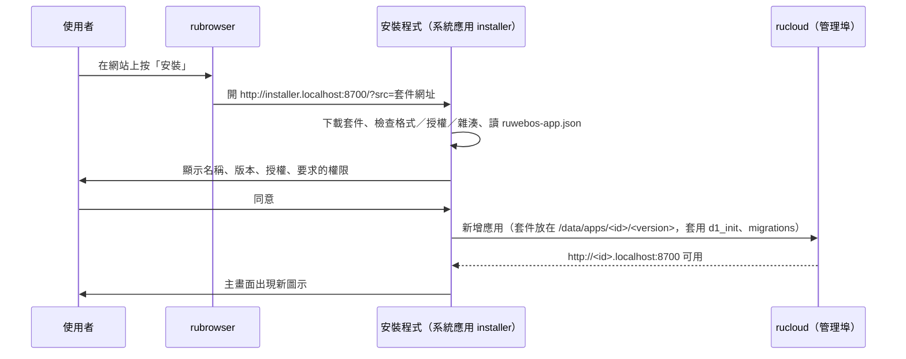

# 軟體安裝（規劃，待確認）

目標：像手機的「加到主畫面」一樣簡單，但「安裝」的意思是**把應用的程式碼搬進 ruwebos，在 VM 裡的 rucloud 執行**，成為 `http://<名稱>.localhost:8700` 的本機應用，並在使用者同意後取得比一般網站更高的權限（例如讀寫「檔案」裡的資料）。

## 兩種「加入」

| | 我的最愛（書籤） | 安裝 |
|---|---|---|
| 程式在哪裡跑 | 原來的網站（例如 `*.workers.dev`） | ruwebos 的 rucloud（VM 裡） |
| 網址 | 原網址 | `http://<名稱>.localhost:8700` |
| 資料在哪裡 | 對方的伺服器 | 資料碟 `/data`（D1、KV、R2） |
| 離線可用 | 否 | 是（除非應用本身要連外） |
| 系統權限 | 無（一般網頁） | 依宣告、經使用者同意才有 |
| 需要什麼 | 只要網址 | 應用要**公開程式碼套件**（見下） |

一個部署在 Cloudflare 的網站，從外面只看得到它的 HTTP 回應，看不到程式碼。所以「安裝」需要應用提供可下載的套件；只有網址的網站只能加成「我的最愛」。

## 應用套件

就是一個 rucloud／wrangler 應用資料夾（`wrangler.jsonc` + `src/` + `public/` + 選用的 `schema.sql`、`migrations/`），打包成 `.tar.gz` 或 `.zip`，另加一個描述檔 `ruwebos-app.json`：

```json
{
  "id": "friendbook",
  "name": "Friendbook",
  "version": "1.2.0",
  "description": "貼文、按讚、留言、追蹤",
  "license": "MIT",
  "source": "https://github.com/ccckmit/friendbook",
  "icon": "public/icon.svg",
  "permissions": ["files:read", "network"],
  "d1_init": { "DB": "schema.sql" }
}
```

* `license`（SPDX 名稱）**必填**：沒有授權的套件不能安裝（延續「映像裡每個套件都要能列出授權」的原則）；安裝後出現在「設定 → 授權」。
* 網站要讓人能安裝，就在網頁裡放 `<link rel="ruwebos-app" href="/ruwebos-app.tar.gz">`，或在 Web App Manifest 加同樣的欄位；rubrowser 看到時，網址列旁出現「安裝」按鈕。
* 也可以直接給套件網址或 Git 儲存庫（安裝程式自己打包）。

## 流程



* **更新**：安裝程式定期（或手動）查套件網址的新版本，有新版時詢問；新版放在另一個資料夾，用 rucloud 的版本機制切換，資料（D1／KV／R2）沿用；新版要更多權限時重新詢問。失敗可回到上一版（`rucloud rollback`）。
* **移除**：問「保留資料」或「連資料一起刪除」，刪除前說明無法復原。
* 名稱衝突：`id` 和已安裝的或系統應用重複時，改用 `<id>-2` 等並告知。

## 權限

「在 localhost」本身不等於有權限。所有 `*.localhost` 應用彼此是不同的來源；權限由 rucloud 對每個應用個別給：

| 權限 | 給什麼 | 實作 |
|---|---|---|
| （預設） | 自己的 D1、KV、R2、Durable Objects，存在資料碟 | rucloud 現有機制，每個應用各自一份 |
| `network` | Worker 可以 `fetch` 外部網站 | rucloud 要新增每個應用的對外連線開關（安裝的應用預設關） |
| `files:read` / `files:write` | 讀／寫「檔案」應用裡使用者的檔案 | 對「檔案」應用的 service binding（只開放讀或讀寫的 API），不直接開放磁碟路徑 |
| `photos`、`songs`、`contacts`、`calendar` … | 各基本應用的資料 | 同上，各應用提供只讀或讀寫的 binding |
| `system:info` | 系統時區、語言、版本 | 「設定」應用的 binding |

* 不開放任意磁碟路徑（rucloud 的 `allow_read`／`allow_write`）給安裝的應用，只開放 service binding 經過的 API：可以檢查、可以記錄、可以收回。
* 使用者可以在「設定 → 應用」看到每個應用的權限並收回；收回後 rucloud 重新載入那個應用。
* Worker 在 rucloud 的 Node 權限沙箱裡跑（不能讀寫自己資料夾以外的檔案、不能開子程序）。

## 要做的事

| # | 項目 | 在哪裡 |
|---|---|---|
| 1 | 套件格式與 `ruwebos-app.json` 的檢查程式 | ruwebos `apps/installer` |
| 2 | 系統應用「安裝程式」：從網址／上傳安裝、權限同意畫面、更新、移除 | ruwebos `apps/installer` |
| 3 | rucloud：由管理埠新增／更新／移除應用（資料夾在 `/data/apps`），開機時載入已安裝的應用；依權限設定 service binding 與對外連線 | rucloud repo（擴充現有的 `[dynamic]`、`deploy`） |
| 4 | 主畫面改成動態：系統應用 + 已安裝的應用 + 我的最愛（目前是建映像時產生的靜態頁） | ruwebos `home` |
| 5 | 「我的最愛」：任何網址加到主畫面（名稱、圖示取自網頁的 manifest 或 favicon） | ruwebos `home` |
| 6 | 「檔案」等基本應用提供給其他應用的 binding API（只讀／讀寫） | ruwebos `apps/*` |
| 7 | rubrowser：偵測 `rel="ruwebos-app"`，網址列旁顯示「安裝」，選單「加到主畫面」 | rubrowser repo |
| 8 | 「設定 → 應用」：權限、版本、授權、資料大小、移除 | ruwebos `apps/settings` |
| 9 | 把 rucloud 的範例應用（friendbook、markpedia…）改成套件：映像裡預先裝好，之後可以像其他應用一樣更新與移除 | ruwebos `image/` |
| 10 | 測試：安裝、權限拒絕、更新、回復、移除（保留／刪除資料）、重開機後仍在 | `apps/test.mjs` |

## 需要你決定的

1. **套件從哪裡來**：只接受「網站自己宣告的套件」與 Git 儲存庫，還是也要一個應用目錄（像 App Store 的清單頁）？
2. **權限的粒度**：上面的表（依基本應用分）是否合適？是否需要「只在使用時詢問」（像手機第一次存取相簿時才問）？
3. **預裝的範例應用**是否改成可移除？
4. **Cloudflare 上的應用**：要不要支援直接從 Cloudflare 帳號匯出（需要 API token，會碰到使用者的帳號），還是只接受公開的套件？
