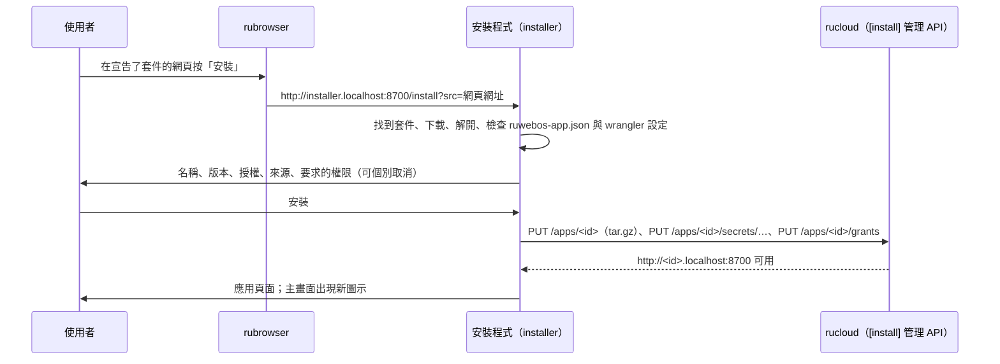

# 軟體安裝

像手機的「加到主畫面」一樣簡單，但「安裝」的意思是**把應用的程式碼搬進 ruwebos，在 VM 裡的 rucloud 執行**，成為 `http://<名稱>.localhost:8700` 的本機應用，並在使用者同意後取得比一般網站更高的權限（例如讀寫「檔案」裡的資料）。

## 兩種「加入」

| | 我的最愛（書籤） | 安裝 |
|---|---|---|
| 程式在哪裡跑 | 原來的網站（例如 `*.workers.dev`） | ruwebos 的 rucloud（VM 裡） |
| 網址 | 原網址 | `http://<名稱>.localhost:8700` |
| 資料在哪裡 | 對方的伺服器 | 資料碟 `/data`（D1、KV、R2、Durable Objects） |
| 離線可用 | 否 | 是（除非應用本身要連外） |
| 系統權限 | 無（一般網頁） | 依宣告、經使用者同意才有 |
| 需要什麼 | 只要網址 | 應用要**公開程式碼套件**（見下） |

一個部署在 Cloudflare 的網站，從外面只看得到它的 HTTP 回應，看不到程式碼。所以「安裝」需要應用提供可下載的套件；只有網址的網站只能加成「我的最愛」（安裝程式的「我的最愛」頁，或 rubrowser 右鍵選單的「加到主畫面」）。

## 流程



* **來源**：網頁宣告的套件（`<link rel="ruwebos-app" href="…">`）、直接的 `.tar.gz` 網址，或 GitHub 儲存庫（`https://github.com/<帳號>/<儲存庫>`，可加 `/tree/<分支>`；安裝程式下載它的封存檔）。不做應用目錄。
* **更新**：應用頁面的「檢查更新」重新從來源下載；版本比較新才更新，新版要的新權限會標出來讓使用者決定。資料沿用；rucloud 保留最近 10 個版本，可以「回到上一版」。
* **移除**：選「保留資料」（重新安裝後還在）或「連資料一起刪除」（無法復原）。
* **預裝的應用**：rucloud 的範例 myshop、friendbook、markpedia、music、boardgame、webportal、ccc 在建置系統碟時打包成套件（`image/gen-packages.mjs`，版本是 `1.0.<改過那個資料夾的 commit 數>`），第一次開機時由安裝程式裝好（它們要求的權限直接給）；系統碟換成較新的版本時自動更新。使用者移除的預裝應用不會再自動裝回來，安裝程式的首頁可以重新安裝。原本在 `rucloud.toml` 裡的同名應用的資料會沿用。

## 應用套件

一個 rucloud／wrangler 應用資料夾（`wrangler.jsonc`、`wrangler.json` 或 `wrangler.toml`，加上 `src/`、`public/`…）打包成 `.tar.gz`，最上層（或唯一的資料夾裡，例如 GitHub 的封存檔）放 `ruwebos-app.json`：

```json
{
  "id": "hello-files",
  "name": "Hello Files",
  "version": "1.0.0",
  "description": "示範：讀寫「檔案」、讀取系統資訊、連到網際網路",
  "license": "MIT",
  "author": "ruwebos",
  "source": "https://github.com/ccc-claude-opus/ruwebos/tree/main/apps/installer/samples/hello-files",
  "icon": "public/icon.svg",
  "color": "#0b7285",
  "permissions": ["files:read", "files:write", "system:info", "network"],
  "secrets": ["AUTH_SECRET"],
  "d1_init": { "DB": "schema.sql" }
}
```

| 欄位 | |
|---|---|
| `id` | 必填。小寫英文、數字與 `-`，成為網址 `http://<id>.localhost`；不能和系統應用同名 |
| `name`、`version` | 必填。版本像 `1.2.0`（可加 `-beta.1` 之類的預先發行標記） |
| `license` | **必填**，SPDX 授權名稱。沒有可用授權的套件不能安裝；安裝後列在「設定 → 授權」 |
| `permissions` | 要求的權限（見下表） |
| `secrets` | 密鑰名稱：安裝程式安裝時各產生一個隨機值（例如簽 session 用的金鑰），更新時沿用 |
| `d1_init` | `{ 綁定: SQL 檔 }`：變成那個 D1 的第一個 migration（安裝的應用會自動套用 `migrations/`） |
| `icon`、`color`、`glyph` | 主畫面的圖示（SVG、PNG、WebP、JPEG，256 KB 以內）；沒有圖示時用 `color` 底加 `glyph` 字 |
| `description`、`author`、`source`、`homepage` | 顯示用 |

`.dev.vars`、`.env`、`.git`、`node_modules` 不會被裝進去；套件解開後上限 200 MB（下載 50 MB）。套件自己的 wrangler 設定裡不能有 `services`、`queues`、`ai`、`analytics_engine_datasets`、`hyperdrive`、`workflows`（會碰到其他應用或伺服器的資源）；D1、KV、R2、Durable Objects、cron 都可以用，資料都是這個應用自己的。

## 權限

「在 localhost」本身不等於有權限。安裝的應用在 rucloud 裡是不可信的程式碼（rucloud 的 `[install]`）：自己的 Worker 程序、Node 的權限沙箱（不能讀寫自己資料夾以外的檔案、不能開子程序）、自己的資料。使用者同意的權限才會變成下面的東西：

| 權限 | 給什麼 | 應用怎麼用 |
|---|---|---|
| `files:read` | 讀取「檔案」裡的檔案 | `env.FILES`：`GET /api/v1/list?dir=`、`GET /api/v1/file?path=`（支援 Range） |
| `files:write` | 在「檔案」裡新增、修改、刪除 | `env.FILES`：`PUT /api/v1/file?path=`（body 是內容）、`DELETE /api/v1/file?path=`（搬到垃圾桶）、`POST /api/v1/mkdir?path=` |
| `system:info` | 時區、語言、系統版本 | `env.SYSTEM`：`GET /api/v1/system` |
| `network` | 連到網際網路 | `fetch()`、`WebSocket`：**只能連網際網路上的位址**，本機、區網（包括 ruvm 的閘道，也就是主機）都擋下 |

* 系統應用的權限是 rucloud 的 service binding，props 是 `{ app, perms }`（Cloudflare 相容的 `ctx.props`，由安裝程式寫進設定，應用改不了）。系統應用依 props 決定能做什麼；安裝的應用只能用 `/api/v1/`，不能碰網頁或表單的路徑。共用的檢查在 `apps/_shared/grant.js`。
* 沒有 `network` 時連 `fetch` 都會丟錯；有的話仍不能連到這台裝置上的其他應用（否則就能繞過上面的權限直接呼叫 `http://files.localhost:8700/`）。`cloudflare:sockets` 與 Node 的網路模組不開放。
* 不開放任意磁碟路徑：只開放經過系統應用 API 的存取，可以檢查、可以收回。

### 什麼時候詢問

**安裝時一次詢問，每項可以個別取消；之後在安裝程式的應用頁面給或收回，或由應用在需要時要求。** 不採用手機那種「第一次用到時才問」：應用的程式是伺服器端的 Worker，它呼叫 binding 時前面不一定有使用者（排程、佇列、Durable Object、另一台裝置的請求），「用到時才問」得讓請求停下來等某個畫面回答。

改由網頁發起：應用在需要時（例如使用者按「從檔案匯入」）把使用者帶到

```
http://installer.localhost:8700/grant?app=<id>&perm=files:read&return=<這個應用的網址>
```

由系統顯示是哪個應用要什麼權限；使用者同意後回到 `return`（必須是這個應用自己的網址）。只能要求套件宣告過的權限。沒有權限時，`env` 裡沒有那個綁定，或系統應用回 403：

```json
{ "error": "permission", "perm": "files:write", "message": "這個應用沒有「files:write」權限" }
```

應用要能照常運作，只是少了那項功能。範例 [apps/installer/samples/hello-files](../apps/installer/samples/hello-files) 示範了這些。

## 元件

| 元件 | 在哪裡 | 做什麼 |
|---|---|---|
| rucloud `[install]` | rucloud repo（`doc/deploy.md` 的「安裝的應用」） | 安裝程式專用的 token；以應用自己的名稱新增、更新、回復、移除；`grants.json`（service binding 與 props、對外連線）；重新開機後還在 |
| 安裝程式 | `apps/installer` | 取得與檢查套件（`src/package.js`、`src/tar.js`）、同意畫面、權限（`src/perms.js`）、更新、移除、預裝應用、我的最愛；`/api/home` 給主畫面 |
| 主畫面 | `home` | 系統應用（建置時的 `public/apps.json`）+ 安裝的應用 + 我的最愛 |
| 系統應用的 API | `apps/files`、`apps/settings`、`apps/_shared/grant.js` | `/api/v1/…`，依 `ctx.props` 檢查權限 |
| 設定 | `apps/settings` | 「應用」分頁標出安裝的應用與權限、連到安裝程式；「授權」列出安裝的應用的授權 |
| rubrowser | rubrowser repo | `--installer URL`：網頁宣告了套件時網址列旁出現「安裝」；右鍵選單「加到主畫面」（啟動器會傳入 `http://installer.localhost:8700/`） |
| 測試 | `apps/installer/test.mjs`、rucloud 的 `tests/e2e/install.test.mjs` | 安裝（部分權限）、權限被拒、要求權限、寫檔、更新檢查、壞的來源、移除；rucloud：props 偽造不了、對外連線、名稱衝突、重新開機、移除後重裝不沿用權限 |

## 還沒做的

* 相簿、音樂、通訊錄、行事曆的權限（`photos:read` 等）：各應用照「檔案」的方式加 `/api/v1/` 與 `src/perms.js` 的一行。
* 定期自動檢查更新（目前是手動「檢查更新」，預裝應用隨系統碟更新）。
* `.zip` 套件、GitHub 以外的 Git 主機（目前請給 `.tar.gz` 的網址）。
* 從 Cloudflare 帳號安裝：見 [todo.md](todo.md) 的未來改良。
* 網路上現成的 Cloudflare 開源應用：候選清單與要先補的（安裝一般的 wrangler 專案、需要 npm 建置的專案）見 [cloudflare-apps.md](cloudflare-apps.md)。

## 決定（2026-11-18）

1. **套件來源**：只接受網站自己宣告的套件與 Git 儲存庫；不做應用目錄。
2. **權限**：依基本應用分讀、寫；安裝時一次詢問、可個別取消，之後在安裝程式或由應用發起的 `grant` 頁補給。
3. **預裝的範例應用**：改成套件，可以更新、也可以移除。
4. **從 Cloudflare 帳號匯出**：先不做。
