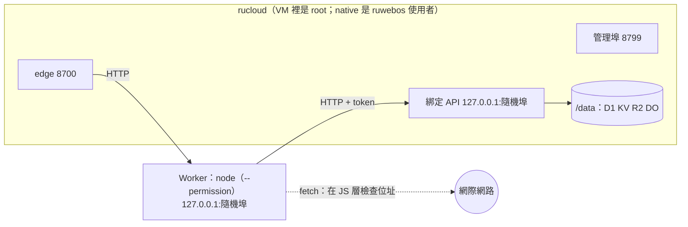
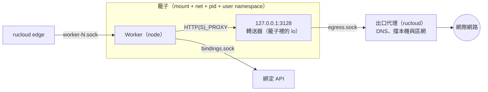

# 作業系統層級的隔離（設計）

2026-11-19。[compat.md](compat.md)「之後」的第 2 項：讓安裝的應用與建置程式關在作業系統層級的籠子裡，Node 那一層（rucloud 的沙箱）被繞過時還有第二道防線。這份是設計，還沒實作；最後面列了要決定的事。

## 威脅模型

**要防的**：安裝的應用的伺服器端程式碼（Worker），以及之後「在系統裡建置」時執行的建置程式。假設它們是惡意的，而且可能找到辦法繞過 Node 的權限模型（Node 官方說明它不是擋惡意程式碼的安全邊界）。

**要做到的**：

| 目標 | 說明 |
|---|---|
| 讀寫不到別人的資料 | 其他應用的 D1、KV、R2、Durable Objects，系統應用的資料（檔案、相片、聯絡人），rucloud 的設定、管理 token、寄信密碼 |
| 連不到本機的服務 | rucloud 的管理埠、其他應用的 Worker、ruvm 的閘道（主機）、區網；沒有 `network` 權限的應用完全沒有網路 |
| 拖不垮系統 | CPU、記憶體、程序數、暫存空間都有上限 |
| 留不下東西 | 程序結束就全部消失；不能留背景程序、不能改系統 |

**不在範圍內**：

* Linux 核心本身的漏洞（namespace 共用同一個核心）。ruwebos 在 ruvm 裡時，整個系統又在一層虛擬機裡，但使用者的資料也在同一台虛擬機裡，所以這一層擋不住資料被讀走。
* 應用在**自己的權限範圍內**作惡（給了 `files:write` 就能改檔案）。
* 瀏覽器端：每個應用有自己的網域，CSRF 已經補了（[todo.md](todo.md)）。
* 旁路攻擊（時間、快取）。

## 現在的樣子

* 每個應用一個或多個 `node` 程序，和 rucloud **同一個使用者**、看得到**整個檔案系統**（只靠 Node 的 `--allow-fs-read` 限制），網路也和 rucloud 共用（只靠 JS 層的檢查）。
* rucloud 和 Worker 之間是本機的 TCP：Worker 聽 `127.0.0.1` 的隨機埠，呼叫綁定 API 也走 `127.0.0.1`。
* Worker 自己寫的檔案只有 SQLite 型 Durable Object 的資料夾（`<state>/<應用>/do-sqlite`）；D1、KV、R2、佇列都是 rucloud 代為存取。這讓籠子可以做得很小。

## 設計

### 工具：bubblewrap

用 [bubblewrap](https://github.com/containers/bubblewrap)（`bwrap`，LGPL-2.0-or-later，Debian 套件）建立 namespace。理由：

* Flatpak 用它，被大量檢查過；
* 不需要 root（用 user namespace），所以 VM 裡（rucloud 是 root）和 native（rucloud 是 `ruwebos` 使用者）都能用；
* 自己用 `unshare`/`clone` 寫也可以，但容易漏掉細節（例如 `/proc` 的掛法、`no_new_privs`）。

rucloud 在 Linux 上偵測到 `bwrap` 時，把 Worker 的啟動指令包成 `bwrap … node host.mjs`。macOS 上（`rucloud dev`）沒有這一層，維持現在的樣子。

### 檔案系統（mount namespace）

Worker 看到的檔案系統只有：

| 路徑 | 方式 | 內容 |
|---|---|---|
| `/usr`、`/lib`、`/bin`、`/etc/ssl` | 唯讀 | Node 與它需要的系統函式庫、CA 憑證；`/etc` 的其他部分不給（DNS 由籠子外的出口代理查） |
| rucloud 的執行環境（`<state>/runtime`） | 唯讀 | `host.mjs` 等 |
| 這個應用目前的版本資料夾 | 唯讀 | 應用的程式碼、`node_modules` |
| `<state>/<應用>/do-sqlite` | 可寫 | SQLite 型 Durable Object |
| `/run/rucloud/<應用>/` | 可寫 | 下面講的 Unix socket |
| `/tmp` | tmpfs，有大小上限 | 暫存 |
| `/proc`、`/dev`（`null`、`zero`、`urandom` 等最少的幾個） | bwrap 建的 | |

`/data` 的其他部分、`/opt/ruwebos`、`/run/ruwebos`（管理 token、系統資訊）、其他應用的資料夾都**不存在**。系統應用的 `allow_read`（例如 `apps/_shared`）照設定唯讀加進去。

### 使用者

* bwrap 加 `--unshare-user`、`--cap-drop ALL`、`--new-session`、`--die-with-parent`，並開 `no_new_privs`。
* VM 裡 rucloud 是 root：Worker 先換成一個沒有權限的使用者（例如 `ruwebos-app`）再進 bwrap，籠子被突破時也不是 root。
* native：rucloud 本來就是 `ruwebos` 使用者，Worker 在 user namespace 裡也沒有多的權限。

### 網路（network namespace）

Worker 放進自己的 network namespace（`--unshare-net`）：裡面只有自己的 `lo`，**連不到任何外面的位址**，包括 rucloud、其他應用、主機、區網。需要的連線都改成 Unix socket，由 rucloud 從籠子外面把 socket 檔放進 `/run/rucloud/<應用>/`：

| 連線 | 現在 | 之後 |
|---|---|---|
| rucloud → Worker | `127.0.0.1:隨機埠` | Worker 聽 `worker-<N>.sock` |
| Worker → 綁定 API | `127.0.0.1:隨機埠` + token | `bindings.sock`（每個應用自己一個，rucloud 從 socket 就知道是哪個應用；token 留著當第二道檢查） |
| Worker → 網際網路 | 直接連，JS 層檢查位址 | **只有 `network` 權限的應用**才有 `egress.sock`：rucloud 的出口代理（HTTP `CONNECT`）在籠子外面查 DNS、拒絕本機、私有網路、CGNAT、連結本地位址，再連出去 |

籠子裡的 `fetch`、`WebSocket` 怎麼走到出口代理：Worker 程序裡開一個小轉送器聽籠子自己的 `127.0.0.1:3128`（別人連不到，因為 `lo` 是這個籠子自己的），把連線轉到 `egress.sock`；Node 用 `NODE_USE_ENV_PROXY=1` 與 `HTTP_PROXY`、`HTTPS_PROXY` 讓內建的 `fetch` 走代理。這樣不用改寫 `fetch`。建置時的 `npm` 也用同樣的方式（`npm` 本來就認得代理設定）。

現在 JS 層的檢查（`host.mjs` 擋本機位址、擋 `node:net`）**留著**，當第一道防線。

### 其他 namespace

`--unshare-pid`（看不到別的程序）、`--unshare-ipc`、`--unshare-uts`、`--unshare-cgroup`。

### 資源上限（cgroup v2）

每個應用一個 cgroup：`memory.max`（和現在的 `memory_mb` 一致，連 Node 堆積以外的記憶體也算）、`cpu.max`（例如最多半顆 CPU）、`pids.max`（例如 64）。

* VM：`/sbin/init` 掛上 `cgroup2`（`/sys/fs/cgroup`），rucloud（root）在 `ruwebos/<應用>/` 底下建。
* native：`ruwebos.service` 加 `Delegate=yes`，systemd 把一個子樹交給 rucloud 管。
* 沒有 cgroup v2 時（例如某些容器裡）照樣跑，只是沒有這一層，並在 log 裡說明。

### 系統呼叫過濾（seccomp）

bwrap 可以載入 seccomp 程式（`--seccomp FD`）。擋掉 Worker 用不到、又常被拿來攻擊核心的系統呼叫：`ptrace`、`mount`、`unshare`／`clone` 建新的 namespace、`keyctl`、`bpf`、`userfaultfd`、`perf_event_open`、`kexec_*` 等。過濾程式由 rucloud 產生（例如用 `seccompiler` crate，Apache-2.0）。這一層放在最後做，因為規則寫錯會讓 Node 起不來，要在 arm64 與 x86_64 上都測過。

### 建置用的籠子

「在系統裡建置」（[compat.md](compat.md) 之後的第 3 項）用同一套設定，差別：

| 項目 | Worker | 建置 |
|---|---|---|
| 程式碼 | 唯讀 | 一個可寫的建置資料夾（`/data/build/<工作>/`，結束就刪） |
| 網路 | 有 `network` 權限才有，任何網際網路位址 | 只能連 npm 的 registry（出口代理用白名單），不接受 git 來源的相依套件 |
| 時間 | 跟著請求 | 上限（例如 10 分鐘） |
| 磁碟 | `/tmp` 上限 | 建置資料夾上限（例如 2 GB） |
| 記憶體 | 應用的 `memory_mb` | 較大（例如 1.5 GB，樹莓派要看機型） |
| 結果 | — | 只拿建置資料夾裡的產物交給安裝程式，照一般套件檢查、安裝 |

### 適用範圍

1. 先套用在**安裝的應用**與 **`[dynamic]` 的應用**（不可信的程式碼）。
2. 確定穩定後，**系統應用**也放進籠子（深度防禦：系統應用若有漏洞被利用，也碰不到別的資料）。系統應用的 `allow_read`、`allow_write` 照設定開。

## 分階段實作

| 階段 | 內容 | 單獨就有的好處 |
|---|---|---|
| A | rucloud 與 Worker 之間改用 Unix socket（Worker 的 HTTP、綁定 API），所有平台都換 | 綁定 API 不再是本機任何程式都連得到的 TCP 埠 |
| B | Linux 上用 bwrap：mount、pid、ipc、user namespace；VM 裡換成 `ruwebos-app` 使用者 | 看不到其他應用與系統的檔案 |
| C | network namespace 與出口代理 | 連不到本機與區網，不靠 JS 層的檢查 |
| D | cgroup v2 的資源上限 | 一個應用拖不垮整台機器 |
| E | seccomp | 減少能攻擊核心的面 |
| F | 系統應用也進籠子 | 深度防禦 |
| G | 建置用的籠子，開放在系統裡建置 | 使用者貼 GitHub 網址就能裝需要建置的專案 |

## 測試

* rucloud 的 e2e（Linux，在 Docker 裡跑）：**關掉 Node 的權限模型**，故意讓 Worker 讀 `/data` 裡別的應用的資料庫、讀管理 token、連 rucloud 的管理埠與其他 Worker、連區網位址、開大量程序、吃光記憶體，全部要失敗；同時確認正常的綁定、`fetch` 網際網路、Durable Object 都還能用。
* ruwebos：14 個應用的測試在 VM（ruvm、QEMU）與 native 都要過。
* 效能：Worker 冷啟動時間與請求延遲，在樹莓派等級的機器上量（bwrap 啟動本身約數毫秒）。

## 要確認的事（實作前）

* ruvm 用的 Debian arm64 核心有開 user namespace、cgroup v2、seccomp（Debian 預設都有，要在 VM 裡實際試）。
* Ubuntu 24.04 等發行版用 AppArmor 限制沒有權限的 user namespace；native 安裝時 bwrap 用發行版自己的套件（有對應的 AppArmor 設定），偵測失敗就退回沒有這一層並明白提示。
* `NODE_USE_ENV_PROXY` 在 ruwebos 用的 Node 版本可用，`WebSocket` 也走代理；不行的話由 `host.mjs` 自己透過代理建立連線。

## 要決定的事

1. **用 bubblewrap**（建議），還是在 rucloud 裡自己寫 namespace 的程式碼（少一個套件，但要自己確保細節正確）。
2. VM 裡 Worker 用**一個共用的** `ruwebos-app` 使用者（建議；應用之間靠 mount namespace 分開），還是**每個應用一個** Linux 使用者（多一層，但要管理 uid）。
3. 系統應用要不要也放進籠子（建議要，在階段 F）。
4. 預設的資源上限（每個應用的 CPU、程序數；建置的時間、磁碟、記憶體）。
