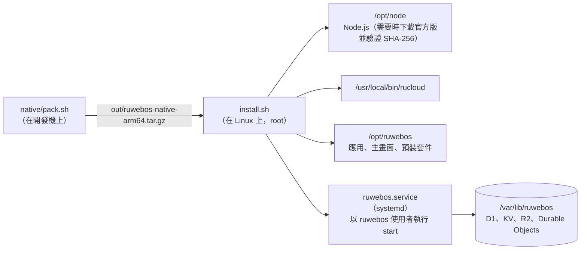

# 直接安裝在 Linux 上（不用虛擬機）

ruwebos 的伺服器端（Node.js、rucloud、應用）可以不經虛擬機，直接裝在 ARM64 的 Linux 上（Debian 13、Raspberry Pi OS），例如樹莓派。應用與設定和系統碟上的完全相同（安裝程式、預裝套件、權限都一樣）；差別是資料放在 `/var/lib/ruwebos` 資料夾，而不是資料碟映像檔。



## 用法

在開發機上做安裝包（會先準備和系統碟一樣的應用）：

```bash
native/pack.sh
```

把 `out/ruwebos-native-arm64.tar.gz` 拷到 Linux 機器上：

```bash
tar -xzf ruwebos-native-arm64.tar.gz
```

```bash
sudo ruwebos-native-arm64/install.sh
```

裝好後是 `http://localhost:8700/`（只聽本機；要讓區網其他機器連，加 `--bind 0.0.0.0`）。再跑一次就是更新，資料保留。移除：

```bash
sudo ruwebos-native-arm64/install.sh --uninstall
```

`--purge` 連資料一起刪除（無法復原）。

| 安裝的東西 | 位置 |
|---|---|
| Node.js（沒有 22.15 以上的版本時，下載和系統碟相同版本的官方 build，比對 SHA-256） | `/opt/node` |
| rucloud | `/usr/local/bin/rucloud` |
| 應用、主畫面、預裝套件 | `/opt/ruwebos` |
| 啟動程式（產生 rucloud 的設定、管理 token、設定 app 顯示的系統資訊） | `/usr/local/lib/ruwebos/start` |
| 設定（`BIND`） | `/etc/ruwebos/ruwebos.conf` |
| 資料 | `/var/lib/ruwebos` |
| 服務（有 systemd 時；結束後 1 秒重新啟動） | `ruwebos.service` |
| 使用者 | `ruwebos`（系統帳號） |

「設定」應用在這種安裝方式下會說明「直接在這台機器上」，網路頁顯示機器真正的網路介面；授權頁列出 ruwebos 安裝的元件（機器本身的作業系統套件不在其中）。

## 測試（Docker）

在這台 Mac 上用乾淨的 Debian 13 arm64 容器測整個安裝流程（容器裡沒有 systemd，所以以 `ruwebos` 使用者直接執行啟動程式），再從主機跑每個應用的測試：

```bash
native/test-docker.sh
```

`--keep` 讓容器留著（`http://localhost:8710/`）。2026-11-19 在 iMac M3 上：安裝（含 apt 與下載 Node.js）約 2.5 分鐘，14 個應用的測試全部通過。

Docker Desktop 在 macOS 上底層也是一台 Linux 虛擬機，但對 ruwebos 而言，它是直接裝在 Linux 上，沒有 ruvm 那一層，和樹莓派上的情況相同。

## 還沒做的

* 開機後自動以全螢幕開瀏覽器（樹莓派：例如 `cage` 加 Chromium 的 kiosk 模式），以及觸控螢幕、系統的虛擬鍵盤：要在實機上做與測。
* x86_64 的安裝包（需要 x86_64 的 rucloud）。
* 從虛擬機的資料碟把資料搬到 `/var/lib/ruwebos`。
* 在 macOS 上直接執行（`./ruwebos --native`，不用 Linux 也不用虛擬機）：下一步。
