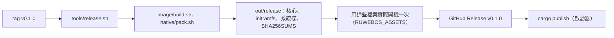

# 發佈新版本

ruwebos 的一個版本有兩個部分：

| 放在哪裡 | 內容 | 給誰用 |
|---|---|---|
| GitHub Release `v<版本>` | `linux`（客體核心）、`initramfs.cpio.gz`、`system.ext4.zst`（系統碟，zstd 壓縮）、`ruwebos-native-arm64.tar.gz`（不用虛擬機、直接裝在 Linux arm64 上）、`licenses.md`、`SHA256SUMS` | 啟動器下載；直接裝在 Linux 上的人 |
| crates.io 的 `ruwebos` | 啟動器（[launcher/](../launcher/README.md)，Rust） | `cargo install ruvm ruwebos` |

啟動器只下載**和自己同版本**的 Release 檔案，所以兩邊的版本號一定一致：以 `launcher/Cargo.toml` 的 `version` 為準。



## 步驟

1. 改 `launcher/Cargo.toml` 的 `version`，commit。
2. 先試一次（不發佈任何東西）：

   ```bash
   tools/release.sh --dry-run
   ```

   會建系統碟與 native 套件、把檔案放進 `out/release/`、對啟動器跑 `cargo publish --dry-run`，並用 `RUWEBOS_ASSETS=out/release` 讓啟動器真的從這些檔案開機一次（用暫時的資料資料夾，不碰你的資料）。
3. 打 tag、push：

   ```bash
   git tag v0.1.0 && git push && git push origin v0.1.0
   ```

4. 發佈（需要 `gh auth login` 與 `cargo login`；會再問一次）：

   ```bash
   tools/release.sh
   ```

   先建 GitHub Release 並上傳檔案，再把啟動器發佈到 crates.io。crates.io 的版本**不能刪除或覆蓋**（只能 yank），Release 的檔案之後還能用同一個指令重新上傳。

## 授權

* 系統碟裡每個套件與它的授權列在 `licenses.md`（建置時由 `image/licenses.sh` 產生）。
* 核心是 Debian 13 的 `linux-signed-arm64`，initramfs 裡是 Debian 的 `busybox-static` 與核心模組，都是 GPL-2.0；Release 的說明寫明對應的原始碼在 Debian 的 sources.debian.org。
* 啟動器是 MIT。

## 啟動器需要 ruvm

啟動器不把 ruvm 編進自己裡面，而是執行 `cargo install ruvm` 裝好的 `ruvm`（或 `RUVM_BIN`）。macOS 的 `-accel hvf` 需要 Hypervisor.framework 的 entitlement，`cargo install` 出來的執行檔沒有簽章，所以啟動器會在資料資料夾裡複製一份 ruvm，用 `codesign --sign -`（ad hoc）加上 entitlement；簽不了就退回較慢的 `-accel tcg`。
