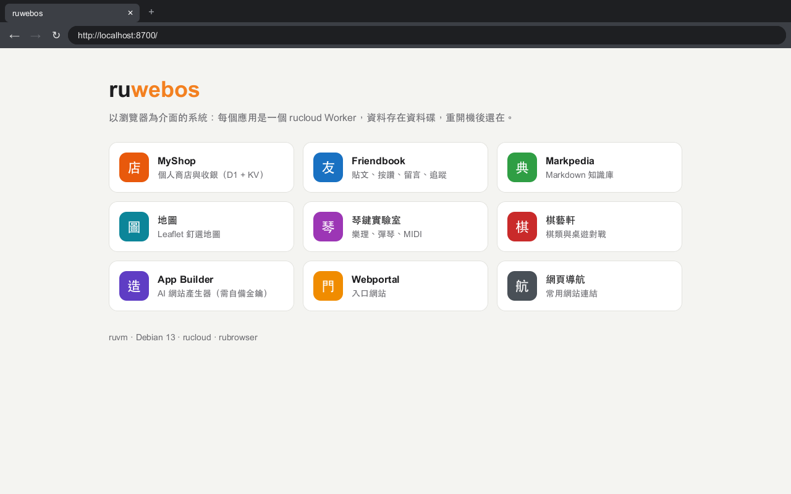
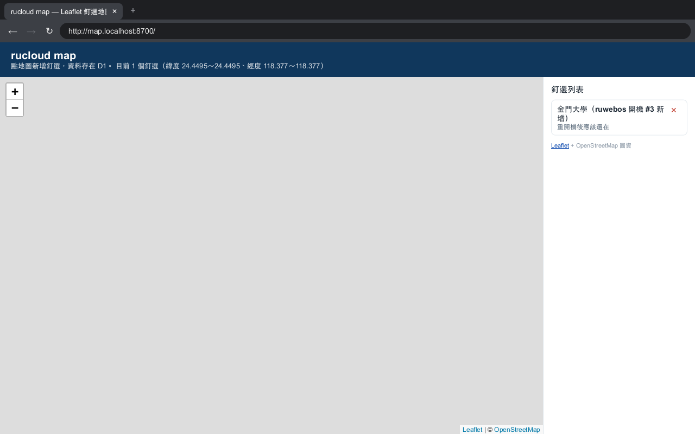
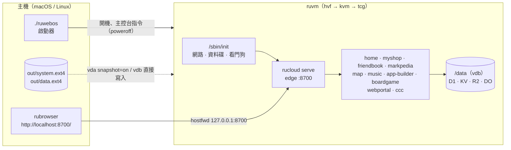

# 階段 1：一鍵啟動的系統映像

[規劃](plan.md)的第一個階段：一個指令從關機狀態開機，在主機的 rubrowser 顯示主畫面，能開啟預裝的應用，資料重開機後還在。

```bash
./ruwebos
```

## 結果（2026-11-18，iMac M3、macOS 26.6、`-accel hvf -smp 4`）

| 項目 | 數字 |
|---|---|
| 啟動器開始 → rucloud 就緒（主機經 hostfwd 拿到主畫面） | 1.40、1.42、1.60 秒（連續三次） |
| 啟動器開始 → rubrowser 畫好主畫面 | **4.70、4.72、4.96 秒**（完成條件是 10 秒內） |
| 其中 rubrowser（debug 版）開啟並畫出主畫面 | 3.1 秒 |
| 客體開機到 `RUWEBOS-READY`（核心計時） | 0.22 秒；ruvm 載入兩顆磁碟與核心約 1.3 秒 |
| 關機（送出 `poweroff` → ruvm 結束） | 約 0.3 秒 |
| 看門狗：rucloud 被 `kill -9` 後恢復服務 | 1.17 秒 |
| `-accel tcg`（直譯器）參考 | 就緒 21.3 秒、主畫面 24.8 秒 |
| 建置系統碟（`image/build.sh`，已有 docker 映像快取時） | 22 秒；檔案 279 MB，`system.ext4` 412 MB |

秒數是 `./ruwebos --screenshot doc/home.png` 印出的，從啟動器開始計時到 rubrowser 寫完截圖；視窗模式（`./ruwebos`）走同一條路，只是 rubrowser 開視窗而不是寫 PNG。



### 資料重開機後還在

1. 開機（第 3 次開機），在地圖應用新增一個釘選（`POST http://map.localhost:8700/api/markers`，就是應用自己的網頁按「儲存」時呼叫的 API），用 rubrowser 開地圖確認列表有它。
2. Ctrl-C：啟動器在主控台打 `poweroff`，init 停掉 rucloud、卸載 `/data`、關機。
3. 重新 `./ruwebos --screenshot doc/map-after-reboot.png http://map.localhost:8700/`（第 4 次開機）：



左邊地圖底圖是灰的：Leaflet 的圖磚是 rubrowser 待補的部分（見「已知問題」），與資料保存無關。之後的開機（測試做到第 16 次）`/api/markers` 都還是同一筆。

九個應用都能經 edge 開啟（`curl http://<名稱>.localhost:8700/` 全部 200，rubrowser 開 `map.localhost` 如上圖）。

## 架構



| 檔案 | 作用 |
|---|---|
| [`ruwebos`](../ruwebos) | 啟動器：選加速器、第一次使用時建系統碟與資料碟、開機、等就緒、開 rubrowser；rubrowser 關掉或 Ctrl-C 就正常關機 |
| [`image/build.sh`](../image/build.sh) | 建 `out/system.ext4` 與 `out/licenses.md` |
| [`image/Dockerfile`](../image/Dockerfile) | 系統碟內容：`node:24-trixie-slim` + e2fsprogs + rucloud + busybox + 應用 + init |
| [`image/init`](../image/init) | `/sbin/init`（不用 systemd） |
| [`image/rucloud.toml`](../image/rucloud.toml) | `rucloud serve` 的多應用設定，`state_dir = "/data/rucloud"` |
| [`image/licenses.sh`](../image/licenses.sh) | 在映像裡產生授權清單 |
| [`home/`](../home) | 主畫面（只有靜態檔案的 rucloud 應用，掛在 `localhost` 與 `127.0.0.1`） |

### 兩顆磁碟

| 磁碟 | 內容 | 掛法 |
|---|---|---|
| `system.ext4`（`/dev/vda`，根目錄） | Debian 13、Node 24、rucloud、`/opt/ruwebos`（設定、home、`rucloud/apps/*`、`rucloud/sites/*`）、init | `-drive file=out/system.ext4,snapshot=on`：客體的寫入只留在記憶體，檔案不變；更新時整顆替換 |
| `data.ext4`（`/dev/vdb` → `/data`） | `rucloud/`（state_dir：每個應用的 D1、KV、R2、Durable Objects）、`log/`（rucloud.log、開機次數） | `-drive file=out/data.ext4`：直接寫回檔案。啟動器第一次建立空檔（預設 512 MB，`DATA_SIZE`），init 發現沒有檔案系統才格式化 |

原本 ruvm 的 `-snapshot` 會套用到所有磁碟，所以在 ruvm 加了 QEMU 語法的逐顆 `-drive file=…,snapshot=on`（ruvm 的獨立 commit）。

### 開機流程

1. ruvm 載入 Debian 的核心與 ruvm 的 initramfs；initramfs 載入 virtio、ext4 模組，掛 `/dev/vda` 並 `switch_root` 到它的 `/sbin/init`。
2. init：掛 proc、sys、dev、tmp、run；掛資料碟（空的就 `mkfs.ext4`、掛不上先 `e2fsck -p`；都失敗時改用 tmpfs 並警告）；設定 `10.0.2.15/24`、閘道 `10.0.2.2`、DNS `10.0.2.3`。
3. 看門狗迴圈執行 `rucloud serve /opt/ruwebos/rucloud.toml`，rucloud 結束就在 1 秒後重啟（關機中除外）。
4. 主畫面回應後在主控台印 `RUWEBOS-READY <秒>`；之後讀主控台的指令：`poweroff`、`status`、`crash-rucloud`（測看門狗）。
5. 啟動器看到 `RUWEBOS-READY` 且主機端 `http://127.0.0.1:8700/` 回應，就開 rubrowser。

### 網址

rucloud 的 edge 依 Host 分派：主畫面是 `http://localhost:8700/`，應用是 `http://<名稱>.localhost:8700/`。`*.localhost` 依 RFC 6761 解析到本機，主機上的 rubrowser 直接可用；ruvm 的 hostfwd 只聽 `127.0.0.1`。

## 授權

`image/build.sh` 在映像裡產生授權清單（`out/licenses.md`，這次的結果複製在 [licenses.md](licenses.md)）：Node.js 與附帶的 npm、corepack、yarn，rucloud 與其 217 個 Rust crate，BusyBox，預裝應用，以及 83 個 Debian 套件（取自各自的 `/usr/share/doc/<套件>/copyright`；不是機器可讀格式的會註明檔案位置）。核心與 initramfs 不在系統碟，來自 ruvm。

## 已知問題與後續

* **rubrowser 的地圖圖磚**：Leaflet 的底圖沒有畫出來，地圖頁因為要從 unpkg 與 OpenStreetMap 載入資源，截圖要約 20 秒。屬於 rubrowser 的工作。
* **rubrowser 用 debug 版**：主畫面 4.7 秒裡有 3.1 秒是 rubrowser；換 release 版會更快。
* **埠固定為 8700**：主畫面的連結寫死 `:8700`，主機上這個埠被占用時啟動器會停下來並說明。
* **ruvm 把磁碟整顆讀進記憶體**：系統碟 412 MB + 資料碟 512 MB 都在主機記憶體裡；資料碟變大時要改成按需讀寫。
* **myshop、friendbook 用範例密鑰**（`.dev.vars.example`）；app-builder 要自備 AI 金鑰才能產生網站。
* **新增資料是用應用的 API**（與應用網頁按鈕呼叫的相同），不是在 rubrowser 視窗裡點選；在 VM 裡跑 rubrowser（階段 2）後可以用輸入事件做完整的端到端測試。
